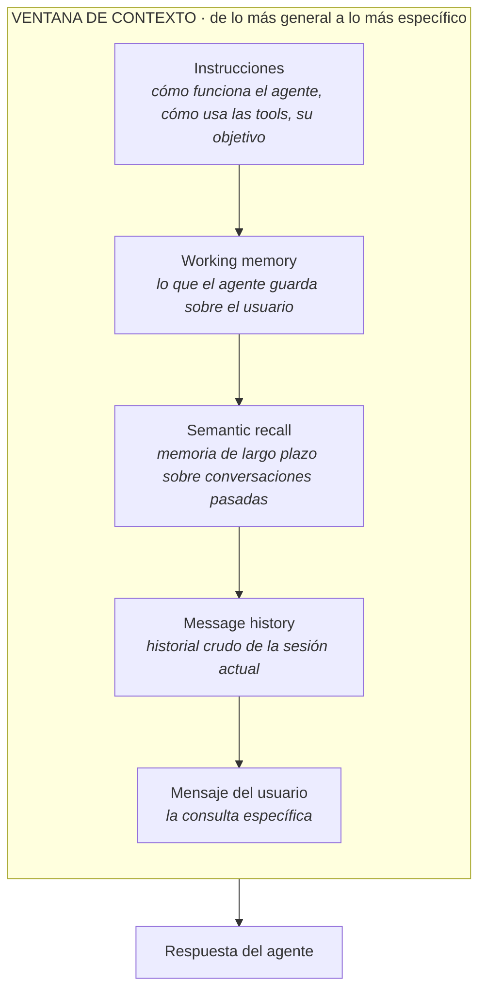
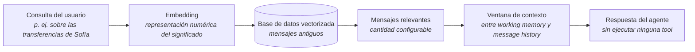

# Semantic Recall: Memoria a Largo Plazo para Agentes

> **Síntesis.** El **semantic recall** es una memoria de largo plazo que deja al agente usar mensajes antiguos que ya salieron de su ventana inmediata: el sistema convierte la consulta del usuario en un **embedding**, busca por significado en una **base de datos vectorizada** y coloca lo encontrado dentro de la ventana de contexto, entre la working memory y el message history, sin que el agente invoque ninguna tool. Con él, el sistema de memoria del agente queda completo: perfil, recuerdos antiguos y conversación reciente trabajan en capas distintas.

## Introducción

Hasta ahora el agente contaba con dos piezas de memoria: el **message history**, que conserva el historial de la sesión, y la **working memory**, un documento que el agente mantiene al día sobre el usuario. Ambas tienen un límite natural: ninguna alcanza a recordar con precisión un mensaje muy antiguo que ya salió del historial reciente. Esta lección añade la pieza que faltaba, el **semantic recall**, y responde a una pregunta concreta: ¿cómo puede el agente apoyarse en algo dicho hace mucho sin cargar toda la conversación pasada en cada turno?

Es una clase corta (unos cuatro minutos) y muy aplicada: primero se explica dónde encaja el semantic recall dentro de la ventana de contexto y cómo funciona la búsqueda por significado; después se le pide a Claude, usado como asistente de código, que lo agregue a un agente construido en Maestra, y se verifica en una demostración. Como prerrequisitos conviene haber visto las clases donde se definió el agente con sus instrucciones y sus tools, y la clase del message history y la working memory.

## Objetivos de aprendizaje

1. **Diferenciar** la working memory, el message history y el semantic recall según su función dentro de la memoria del agente conversacional.
2. **Describir** el orden de los elementos en la ventana de contexto: instrucciones, working memory, semantic recall, message history y mensaje del usuario.
3. **Explicar** cómo funciona el semantic recall mediante embeddings y búsqueda semántica en una base de datos vectorizada.
4. **Identificar** los tres componentes necesarios para implementarlo y cómo se configura su activación, incluida la cantidad de mensajes a recuperar.
5. **Verificar** que el agente recupera información fuera del message history sin usar una tool.

## Marco conceptual

### Tres capas de memoria

El **message history** es el historial crudo de la sesión: los mensajes tal como se intercambiaron, sin procesar. La **working memory** es un documento que el agente mantiene actualizado sobre el usuario, algo así como su ficha de trabajo. El **semantic recall** es la memoria de largo plazo: permite usar mensajes mucho más viejos que ya no forman parte de la ventana inmediata. La diferencia de fondo con el message history es el alcance: este solo contiene lo conversado en la sesión actual, mientras que el semantic recall puede traer información guardada en cualquier momento anterior, siempre que esté relacionada por significado con lo que el usuario pregunta ahora.

La analogía de la **biblioteca** ayuda a ubicar cada capa. El message history se parece a una conversación reciente que tenemos fresca en la memoria: sabemos qué se dijo hace un rato sin esfuerzo. La working memory se parece a una ficha resumen sobre nosotros, que consultamos para recordar quiénes somos y qué nos interesa. El semantic recall equivale a ir a los archivos de la biblioteca y buscar lo que se relaciona con lo que estamos preguntando, aunque no recordemos las palabras exactas con que lo dijimos. Para la teoría general de la ventana de contexto y de la memoria de corto y largo plazo, véase [Memoria en Agentes de IA: Fundamentos](./01-ai-agent-memory-fundamentals.md); aquí solo interesa cómo se suma esta tercera capa.

### Cómo funciona: embeddings y búsqueda semántica

Según la documentación de Maestra, el mecanismo parte del prompt del usuario. El sistema lo transforma en un **embedding**, una representación numérica del significado de ese texto, y con ese vector consulta una **base de datos vectorizada**, es decir, un almacén donde los mensajes antiguos están guardados también como vectores. La comparación se hace entre significados, no entre cadenas de caracteres: un mensaje del pasado puede resultar relevante aunque no comparta ninguna palabra literal con la consulta actual. De ahí el nombre **recall semántico**.

En términos de la analogía, es como disponer de un archivo completo de conversaciones pasadas y encontrar las partes pertinentes por su sentido, aunque hayan ocurrido hace mucho. Esta idea de recuperar por cercanía de significado ya se desarrolló, con más detalle técnico, en la sesión sobre implementación con `pgvector`: [Implementación de Memoria a Largo Plazo con Supabase](./05-long-term-memory-implementation.md).

### El orden de la ventana de contexto

Las instrucciones y todo el sistema de memoria entran en la **ventana de contexto**, que es la información que el agente tiene a la vista al escuchar el prompt y generar la respuesta (el concepto y sus límites se tratan en [Context Rot y Context Engineering: por qué una ventana grande no basta](./02-context-rot-and-context-engineering.md)). Dentro de ella, los elementos se ordenan de lo más general a lo más específico, y el semantic recall ocupa un lugar intermedio.

Leído de arriba hacia abajo, primero llegan las reglas del agente; luego lo que sabe del usuario; después los fragmentos del pasado relacionados con la consulta; a continuación la conversación en curso; y al final la pregunta concreta. El semantic recall queda entre la working memory y el message history porque aporta contexto más específico que el perfil del usuario, pero más amplio en el tiempo que el historial de la sesión actual.

### Los tres componentes para implementarlo

Para que el semantic recall funcione hacen falta tres piezas, cada una con un papel distinto en el flujo.

| Componente | Función |
|---|---|
| **Base de datos vectorizada** | Guarda y permite consultar la información de largo plazo en forma de vectores. |
| **Embedder** | Convierte los mensajes en vectores para que puedan buscarse por significado. |
| **Configuración de activación** | Parte del código que enciende el semantic recall dentro de las opciones de memoria del agente, incluyendo cuántos mensajes se traen en cada consulta. |

Conviene retener la lógica de conjunto: sin embedder no hay vectores que guardar, sin base vectorizada no hay dónde buscar, y sin configuración el agente no activa la capacidad. La cantidad de mensajes a recuperar es una decisión de diseño que equilibra riqueza de contexto frente a espacio ocupado en la ventana.

### Implementación con Claude

En la demostración se le pide a Claude que agregue el semantic recall al código del agente construido en Maestra. Al revisar el sistema de memoria, Claude añadió tres cosas: la configuración de semantic recall dentro de las opciones de memoria (incluyendo cuántos mensajes traer), la base de datos vectorizada y el sistema de embeddings. Es decir, los tres componentes de la sección anterior.

Hubo además un cambio que no pertenece a esas tres piezas: Claude sumó a las instrucciones del agente indicaciones sobre cómo usar la working memory. Esto se alinea con la jerarquía de la ventana de contexto, donde las instrucciones vienen primero y gobiernan el modo en que el agente aprovecha lo que viene después. Al revisar el trabajo de un asistente de código, una buena comprobación es verificar que estén presentes los tres componentes y que la activación quede dentro de las opciones de memoria.

### Prueba práctica: recuperar sin tool

Con el semantic recall activado, se le pide al agente "trae las transferencias de Sofía". Más adelante, cuando ese mensaje ya salió de la ventana del message history, se vuelve a consultar sobre lo mismo. El agente responde correctamente sin usar ninguna tool: accede directamente a la base vectorizada mediante el semantic recall.

En el panel de memoria del estudio de Maestra se comprueba qué ocurrió: aparece el semantic recall activado y los mensajes relevantes que devolvió la búsqueda semántica de "Sofía", por ejemplo "Encontré las transferencias de Sofía" junto con la consulta original. Que el agente no necesite una tool es la señal clave de la verificación: la información no vino de afuera, sino de su propia memoria. El flujo completo se resume así:

### Semantic recall vs message history vs tools

Los tres mecanismos pueden aportar información al agente, pero cubren casos distintos y no se sustituyen entre sí.

| Mecanismo | Qué cubre | De dónde saca la información | ¿Requiere una acción externa? |
|---|---|---|---|
| **Message history** | Lo dicho en la sesión actual y reciente | Del historial de la propia sesión | No |
| **Semantic recall** | Información antigua relacionada por significado con la consulta | De la base de datos vectorizada de mensajes pasados | No |
| **Tool** | Información nueva que el agente no tiene | De un sistema externo, mediante una acción explícita | Sí |

La regla práctica es que el agente use su memoria cuando la respuesta ya está en lo que vivió, y recurra a una tool cuando necesita algo nuevo del exterior, como consultar un sistema externo. En la demo, al preguntar por las transferencias de Sofía el agente resuelve con su propia memoria porque esa información ya había aparecido antes en la conversación.

## Síntesis

El semantic recall completa el sistema de memoria del agente junto con la working memory y el message history: la working memory guarda lo esencial sobre el usuario, el message history sostiene la conversación en curso y el semantic recall rescata, por significado, lo dicho mucho antes. Técnicamente descansa en tres componentes (base de datos vectorizada, embedder y configuración de activación) y en un flujo simple: la consulta se vuelve embedding, se busca en la base vectorizada y los mensajes hallados se inyectan en la ventana de contexto, en el punto intermedio entre el perfil del usuario y el historial de la sesión. Lo que lo distingue de una tool es que no exige ninguna acción externa: el agente responde con memoria propia, como mostró la demostración de las transferencias de Sofía.

## Preguntas de repaso

1. ¿Qué diferencia hay entre working memory, message history y semantic recall? Apóyate en la analogía de la biblioteca.
2. ¿En qué orden se disponen los elementos dentro de la ventana de contexto y por qué el semantic recall queda entre la working memory y el message history?
3. ¿Cómo busca el semantic recall la información y por qué no depende de que la consulta contenga la palabra literal del mensaje original?
4. ¿Qué tres componentes hacen falta para implementarlo y qué función cumple cada uno? ¿Qué se configura además en la activación?
5. En la demo, ¿por qué el agente no necesita una tool para recuperar las transferencias de Sofía? ¿En qué caso sí sería necesaria una tool?

## Recursos

- [Supabase — AI & Vectors (pgvector)](https://supabase.com/docs/guides/ai) — documentación sobre vectores y búsqueda vectorial con `pgvector`, el equivalente en nuestro proyecto de la base de datos vectorizada.
- Conexión interna: [Memoria en Agentes de IA: Fundamentos](./01-ai-agent-memory-fundamentals.md) — ventana de contexto y panorámica de memoria de corto y largo plazo, base teórica de esta clase.
- Conexión interna: [Context Rot y Context Engineering: por qué una ventana grande no basta](./02-context-rot-and-context-engineering.md) — por qué importa decidir qué entra a la ventana de contexto, lo que justifica traer solo un número acotado de mensajes.
- Conexión interna: [Fundamentos de Memoria a Largo Plazo en Agentes de IA](./04-long-term-memory-fundamentals.md) — el enfoque de memoria a largo plazo de nuestro proyecto, con el que esta clase se contrasta.
- Conexión interna: [Implementación de Memoria a Largo Plazo con Supabase](./05-long-term-memory-implementation.md) — la recuperación por similitud con embeddings y `pgvector`, llevada a código.
- Conexión interna: [Implementación de Human in the Loop en LangGraph](../week-05/03-human-in-the-loop-langgraph.md) — human in the loop, el tema que el temario anuncia para la clase siguiente.

## Notas personales

> Contraste entre esta clase y lo que ya se vio en el curso (semana 6 y semana 5). Lo marcado como *pendiente* está inferido y hay que confirmarlo.

### Mismo objetivo, distinto mecanismo

En las sesiones 4 y 5 de esta semana, el proyecto destila recuerdos al **cerrar la sesión** (*memory flush*): un LLM lee la conversación, extrae hechos durables y los guarda en una tabla de Supabase junto con su embedding en `pgvector`. Al iniciar un turno, se recuperan por similitud de coseno los más cercanos (un top de 5 a 8) y se inyectan en el `systemPrompt`. El semantic recall de esta clase persigue lo mismo, recordar por significado lo que ya no está a la vista, pero lo plantea como una capa dentro de la ventana de contexto: recupera mensajes antiguos parecidos a la consulta, en una cantidad configurable, y los sitúa entre la working memory y el message history. *Pendiente:* confirmar si en esta clase los mensajes se indexan tal cual o se destilan antes, y si existe algún equivalente al `retrieval_count` o a la deduplicación; el temario no lo dice.

### Trampa de nombres

La "memoria semántica" de la semana 6 es un **tipo** de memoria (hechos y conocimiento general del usuario, junto a la episódica y la procedimental), mientras que el "semantic recall" de esta clase es un **mecanismo de recuperación** por significado. El parecido de los nombres invita a confundirlos, pero uno describe qué se guarda y el otro cómo se busca.

### Orden del curso

El temario anuncia human in the loop como "la próxima clase", pero en este repo ya se vio en [week-05/03](../week-05/03-human-in-the-loop-langgraph.md) (con LangGraph), antes de la memoria. Es una pista de que esta clase es complementaria y no parte de la secuencia de la semana 6. *Pendiente:* confirmar en LAB10 a qué módulo pertenece.
