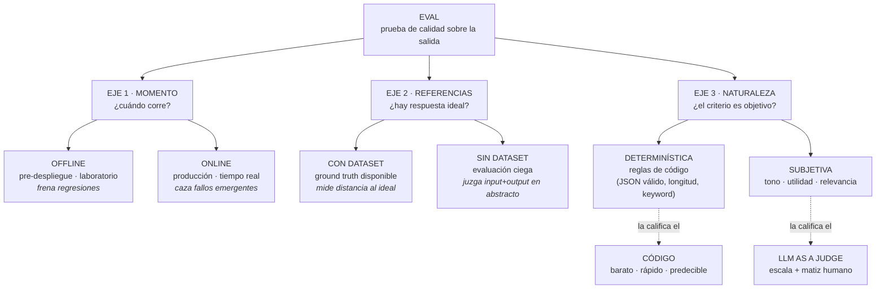

# Evaluación de Agentes con LLM as a Judge

> **Síntesis.** Como un LLM es **probabilístico** —la misma pregunta admite mil respuestas distintas, todas plausibles—, no se prueba con un `assert` binario sino con **evals**: pruebas sistemáticas, repetibles y cuantificables sobre sus salidas. Cuando lo que hay que medir es **objetivo** (¿el JSON es válido?, ¿contiene la palabra clave?), el código determinista basta y es más barato, rápido y predecible. Pero cuando la calidad es **subjetiva** —utilidad, tono, relevancia, cortesía—, ningún `if` la captura: ahí entra el **LLM as a Judge**, un segundo modelo que actúa de árbitro y califica las respuestas del agente contra una rúbrica. La regla de oro que hace confiable a ese juez es contraintuitiva: hay que exigirle **siempre el razonamiento paso a paso ANTES de la nota numérica**; pedir la calificación primero degrada la evaluación. Y la observabilidad de las sesiones anteriores es el insumio directo: las trazas capturadas son, literalmente, lo que estos evaluadores leen y puntúan.

## Introducción

Toda la semana ha construido hacia este momento. Sabíamos *por qué* evaluar (sesión 1), *qué* evaluar —output vs. trajectory, offline vs. online— (sesión 2), cómo *capturar* las ejecuciones con Langfuse (sesión 3) y cómo *leer* esas trazas para depurar (sesión 4). Pero quedó pendiente el problema de escala: un humano puede juzgar a mano diez respuestas, quizá cien; jamás los millones que produce un agente en producción. Y precisamente la parte más valiosa de la calidad —¿fue *útil* esta respuesta?, ¿sonó *empática*?, ¿se *salió del tema*?— es la que ningún test tradicional sabe medir, porque no hay una respuesta "correcta" única que comparar con un `==`.

Esta clase resuelve ese cuello de botella con una técnica central: usar **otro LLM como juez**. La idea es sencilla de enunciar y delicada de ejecutar bien —de hecho, la sesión 2 la marcó como **bandera roja** cuando se usa sin cuidado—. Esta sesión es el "cómo hacerlo bien" de aquel riesgo: cómo diseñar el prompt del juez, qué exigirle, cuándo *no* usarlo (prefiriendo código determinista), y cómo montarlo en Langfuse para que corra automáticamente sobre las trazas que ya estamos capturando.

El hilo narrativo es un caso concreto: **Olivia**, el agente de soporte ficticio de **Lab 10**. Le construiremos dos evaluadores —uno que mide si sus respuestas son útiles (`helpfulness`) y otro que detecta cuando un usuario pregunta algo fuera del negocio (`out_of_scope`)—, y en el camino veremos por qué el orden de un prompt evaluador no es un detalle estético sino la diferencia entre un juez fiable y uno que inventa notas.

## Objetivos de aprendizaje

1. **Explicar** qué es un *LLM as a Judge* y qué rol cumple dentro de las metodologías de evaluación de agentes de IA.
2. **Clasificar** las evaluaciones según tres ejes: el momento de ejecución (online/offline), el uso de referencias (con o sin dataset) y su naturaleza (determinística o subjetiva).
3. **Configurar** evaluadores personalizados en Langfuse —como `helpfulness` y `out_of_scope`— conectando un modelo Gemini vía Google AI Studio.
4. **Diseñar** prompts de evaluación que exijan razonamiento paso a paso *antes* de emitir la calificación numérica.
5. **Analizar** los resultados en producción para iterar los prompts, ajustar el sampling y asegurar la confiabilidad del sistema de evaluación en el tiempo.

## Marco conceptual

### ¿Qué es un LLM as a Judge?

Un **eval** (*evaluation*) es una prueba sistemática, repetible y cuantificable que mide la calidad de las salidas de un modelo o agente. Es el análogo de los tests de software, con una diferencia decisiva: el software determinista admite un `assert` binario —la función devuelve 42 o no lo devuelve—, mientras que la salida de un LLM es **abierta y probabilística**, así que no existe un único resultado "correcto" contra el cual comparar. Un eval necesita, por eso, tres piezas: un conjunto de entradas, la ejecución que produce las salidas —que se apoya en la observabilidad de las sesiones previas: sin trazas capturadas no hay nada que calificar— y un **scorer** o calificador que emita el veredicto.

El **LLM as a Judge** es un tipo particular de scorer: un **LLM secundario que analiza, califica y audita las respuestas del agente principal** según criterios predefinidos. Actúa como un árbitro automático. Su virtud es que combina lo mejor de los otros dos calificadores posibles: escala como un scorer determinista —puede juzgar millones de salidas sin cansarse— pero capta los matices que antes solo un revisor humano sabía apreciar (¿esta respuesta fue empática?, ¿fue realmente útil o solo correcta?). Donde una regla de código se estrella —no hay `regex` para "utilidad"—, el juez LLM lee la respuesta con la misma flexibilidad que una persona y la puntúa contra una rúbrica. Esa es su razón de ser: llevar el juicio cualitativo humano a la escala de la máquina.

### El framework de clasificación de evals — 3 ejes

No todas las evaluaciones son iguales, y confundirlas lleva a elegir la herramienta equivocada. Conviene ordenarlas con **tres ejes independientes**, que se combinan libremente entre sí.

El primer eje es el **momento de ejecución**. Una eval **offline** corre antes del despliegue, en el laboratorio, contra casos preparados; su misión es frenar regresiones. Una eval **online** corre en producción, en tiempo real, sobre el tráfico de usuarios reales; su misión es cazar los fallos emergentes que ningún dato sintético anticipó. Es el eje que ya vimos en la sesión 2.

El segundo eje es el **uso de referencias**. Una eval **con dataset** dispone de un *ground truth* —la respuesta ideal esperada— y mide qué tan cerca estuvo la salida real de ese ideal. Una eval **sin dataset** es una evaluación "ciega": no hay respuesta modelo contra la cual comparar, así que el juicio se emite solo a partir de la entrada y la salida observadas. El LLM as a Judge brilla especialmente aquí, porque puede valorar una respuesta *en abstracto* —"¿fue útil?"— sin necesitar una referencia perfecta precalculada.

El tercer eje es la **naturaleza** del criterio. Una eval **determinística** aplica reglas de código verificables y sin ambigüedad: ¿el output es un JSON válido?, ¿tiene menos de 280 caracteres?, ¿contiene el número de pedido? Una eval **subjetiva** mide cualidades que no admiten una regla fija: tono, utilidad, relevancia, seguridad. Este es el eje que decide *quién* debe ser el calificador —el código para lo determinístico, el LLM-juez para lo subjetivo—.



Leído de arriba hacia abajo: una misma eval se sitúa simultáneamente en los tres ejes —puede ser, por ejemplo, *online + sin dataset + subjetiva*, que es exactamente el perfil de los evaluadores de Olivia—. El tercer eje es el que delega el trabajo: lo **determinístico** al código, lo **subjetivo** al juez LLM.

### Priorización determinística vs. subjetiva

De los tres ejes, el de la naturaleza esconde la regla operativa más importante: **si el código puede medirlo, que lo mida el código**. Un scorer determinista —comprobar que la respuesta es un JSON bien formado, que menciona el número de factura, que no supera cierta longitud— es más **rápido, más barato y perfectamente predecible**: dada la misma entrada, devuelve siempre el mismo veredicto, sin llamadas a una API, sin coste por token, sin la variabilidad de otro modelo. Reservar el LLM-juez para todo sería como contratar a un perito para verificar si un formulario tiene todos los campos llenos: un desperdicio.

La consecuencia práctica es una jerarquía de decisión. Antes de escribir un prompt evaluador, hay que preguntarse: *¿esto lo puede medir una regla?* Si la respuesta es sí, se implementa como eval determinística. El LLM as a Judge se reserva para lo que el código genuinamente no alcanza: las cualidades subjetivas donde no existe una regla que las capture. El juez es una herramienta potente, pero también la más cara y la menos predecible del arsenal; usarla con criterio es parte de la disciplina.

### Rigurosidad según el impacto del agente

Cuánta evaluación es "suficiente" no tiene una respuesta única: **depende del impacto del agente**. Un agente que da la cara al usuario final o que participa en un proceso crítico —un asistente médico, un bot financiero, el soporte de cara al cliente como Olivia— exige una evaluación **rigurosa**, con múltiples evaluadores, monitoreo continuo y calibración frecuente, porque cada fallo tiene consecuencias visibles y costosas. En cambio, una herramienta interna de baja criticidad —un script que resume notas para consumo propio— admite una evaluación **más liviana**, porque el coste de un error ocasional es pequeño.

Este principio evita dos errores simétricos: sub-invertir en la evaluación de un sistema de alto riesgo (y descubrir los fallos por las quejas de los usuarios) o sobre-invertir en uno trivial (y quemar tiempo y presupuesto de tokens vigilando algo que no lo amerita). El nivel de rigor es una decisión de ingeniería, no un valor fijo.

### Anatomía de un prompt evaluador

Un evaluador LLM es, en el fondo, un prompt bien estructurado. Cinco piezas lo componen y ninguna es prescindible. Primero, el **rol del evaluador**: instrucciones que fijan la persona del juez —"Eres un evaluador de calidad estricto e imparcial…"—, que encuadran su severidad y su objetividad. Segundo, las **variables de contexto**: los datos que el juez necesita para emitir su juicio, típicamente la entrada del usuario y la salida del agente, inyectadas mediante *placeholders* como `{{user_input}}` y `{{agent_output}}` que Langfuse rellena con los valores de cada traza. Tercero, la **escala** de calificación —por ejemplo binaria `0/1`, o un rango `1–5`—, que define el vocabulario del veredicto. Cuarto, los **criterios exactos por puntaje**: qué significa cada nota, para que el juez no improvise ("1 = resuelve completamente la duda; 0 = no la resuelve o la ignora").

La quinta pieza es la más crítica y da nombre a la regla de oro de la sesión: exigir el **razonamiento paso a paso ANTES de la calificación numérica**. El prompt debe ordenar explícitamente al juez que *primero* explique su análisis —qué observó, cómo lo contrastó con los criterios— y *solo después* emita el número. El orden no es cosmético: un LLM que escribe primero la nota queda **anclado** a ese número y luego fabrica una justificación que lo respalde, en lugar de razonar de verdad. Forzar el razonamiento primero convierte la calificación en la *conclusión* de un análisis, no en un impulso que se racionaliza a posteriori. Pedir la nota antes del razonamiento **degrada** medible­mente la evaluación; es el error de diseño más común y más fácil de evitar.

### Langfuse y su rol en la evaluación

Langfuse cierra el círculo de la semana porque hace las dos cosas a la vez. Por un lado **captura las trazas** en vivo —lo que ya aprendimos a instrumentar (sesión 3) y a leer (sesión 4)—; por otro, permite **configurar evaluadores automáticos** que corren en **segundo plano** sobre esas trazas, calificándolas sistemáticamente sin intervención humana. El evaluador se define una vez —modelo, prompt, escala, mapeo de variables— y a partir de ahí puntúa cada nueva traza (o una muestra de ellas) conforme llegan.

Esta integración es lo que hace concreta la frase que atraviesa toda la semana: la observabilidad **captura** lo que hizo el agente; la evaluación **califica** sobre lo capturado. El evaluador LLM no juzga en el vacío: lee el `input` y el `output` que la traza registró y les asigna una nota, que Langfuse guarda como un *score* asociado a esa traza. Así, la misma plataforma que usábamos para depurar de forma reactiva se vuelve también un motor de evaluación continua.

### ⚠️ Advertencias

El poder del LLM-juez viene con una letra pequeña que conviene tener presente. La primera advertencia es que **los jueces también alucinan y sesgan**: cargan las mismas debilidades de cualquier LLM —favoritismo por respuestas más largas, por cierto estilo, por su propia familia de modelos, sensibilidad al orden de presentación—. Un juez no es un oráculo objetivo; es otro modelo falible aplicado a una tarea de arbitraje. De ahí se sigue que **los prompts evaluadores hay que iterarlos**: el primer diseño rara vez es el bueno, y afinarlo —ajustar criterios, endurecer el rol, precisar la escala— es parte del trabajo, no un fracaso.

La segunda advertencia es operativa: **hay que monitorear el juez en producción**. Sus calificaciones pueden derivar con el tiempo, sobre todo si el modelo subyacente se actualiza y desplaza silenciosamente su vara de medir. Y la tercera reitera la regla de oro por su importancia: **pedir la nota antes del razonamiento degrada la evaluación**; el orden razonamiento→número es innegociable. Todo esto enlaza directamente con la **bandera roja** que levantó la [sesión 2](./02-evaluation-and-observability-of-ai-agents.md): confiar a ciegas en un LLM-as-a-judge *sin calibración humana periódica*. Esta sesión enseña a construir el juez bien; aquella recuerda que, por bien construido que esté, un humano debe auditar cada tanto una muestra de sus veredictos para confirmar que sigue alineado. El juez escala el trabajo; el humano mantiene la vara honesta.

## Guía práctica

### Creación de evaluadores en Langfuse

El objetivo de esta guía es construir, para el agente **Olivia** de **Lab 10**, dos evaluadores automáticos que corran sobre sus trazas: `helpfulness`, que mide si sus respuestas son útiles, y `out_of_scope`, que detecta cuando un usuario pregunta algo ajeno al negocio. El recorrido asume que Olivia ya está conectado a Langfuse y generando trazas (sesiones 3 y 4).

#### Preparación

1. Inicia sesión en Langfuse y entra al **proyecto** del agente de soporte Olivia.
2. Verifica que existan **trazas previas** con datos reales —el evaluador necesita ejecuciones que calificar; si el proyecto está vacío, genera primero algunas interacciones—.
3. Ve a **Settings > Integrations** y conecta una **API Key de Google AI Studio**. Esta es la que habilitará usar un modelo **Gemini** como motor del juez. (La key se obtiene en [Google AI Studio](https://aistudio.google.com); guárdala como se guarda cualquier credencial sensible.)

#### Paso 1 — Crear el evaluador `helpfulness` (utilidad)

1. Abre la pestaña **Evals** en el menú lateral y pulsa **Create Evaluator**.
2. Nómbralo `helpfulness`.
3. Selecciona el **modelo** que hará de juez: un **Gemini** disponible a través de la integración de Google que conectaste en la preparación.
4. Entra al **editor de prompts** para diseñar el criterio de evaluación.

#### Paso 2 — Diseñar el prompt con razonamiento primero

El prompt debe seguir la anatomía de cinco piezas y, sobre todo, exigir el razonamiento **antes** de la nota. Se define una escala binaria `0/1`, se explican los criterios de cada valor y se mapean las variables `{{user_input}}` y `{{agent_output}}` al **input** y al **output** de las trazas para que Langfuse los rellene automáticamente en cada ejecución.

```text
Eres un evaluador de calidad estricto e imparcial de un agente de soporte.

Vas a juzgar si la respuesta del agente fue ÚTIL para el usuario.

Pregunta del usuario:
{{user_input}}

Respuesta del agente:
{{agent_output}}

Escala de calificación:
- 1 = la respuesta resuelve o hace avanzar de forma clara la duda del usuario.
- 0 = la respuesta no resuelve la duda, es vaga, incorrecta o la ignora.

INSTRUCCIÓN CRÍTICA: primero escribe tu RAZONAMIENTO paso a paso
analizando la respuesta contra los criterios. SOLO al final, en una
última línea, emite la calificación numérica (0 o 1).
```

Antes de continuar, verifica que la sintaxis de los *placeholders* sea correcta y que estén efectivamente enlazados a los campos `input`/`output` de las trazas; un mapeo mal escrito hace que el juez reciba variables vacías y califique a ciegas.

#### Paso 3 — Probar, verificar el orden y activar

1. Usa **Run Test** sobre una **traza reciente** de Olivia para ejecutar el evaluador en un caso real.
2. Revisa la salida del juez y confirma lo esencial: que haya un **párrafo de razonamiento primero** y **el número al final**. Si aparece la nota antes del análisis, corrige el prompt y vuelve a probar —ese orden es lo que garantiza la fiabilidad—.
3. Cuando el comportamiento sea el esperado, **guarda y activa** el evaluador para que empiece a calificar automáticamente las trazas entrantes.

#### Paso 4 (opcional) — Evaluador `out_of_scope` con sampling

1. Repite el flujo anterior creando un segundo evaluador llamado `out_of_scope`, con la misma exigencia de razonamiento-antes-de-nota.
2. Invierte la lógica de la escala según el criterio de negocio: **1 si la pregunta es irrelevante** al dominio del agente (fuera de alcance) y **0 si es pertinente**. Así, un `1` es una señal de alarma —el usuario preguntó algo que Olivia no debería responder—.
3. Ajusta el **sampling al 20 %** para **optimizar costos**: no hace falta pasar el juez por cada traza; una muestra representativa basta para vigilar la tendencia sin disparar el gasto de tokens.
4. Pruébalo con un **caso atípico** deliberado —por ejemplo, un usuario que le pregunta a un agente de soporte técnico una **receta de cocina**— y confirma que el evaluador lo marca como fuera de alcance (`1`) con su razonamiento correspondiente.

## Síntesis

Con esta sesión el arco de la semana queda completo y cerrado. Empezamos con el **diagnóstico** —por qué el monitoreo clásico no basta (s1)—, seguimos con el **mapa** —qué evaluar y dónde: output vs. trajectory, offline vs. online, y la primera mención del LLM-juez como *bandera roja* sin calibración (s2)—, **instrumentamos** la captura enganchando Langfuse al agente (s3), aprendimos a **leer y depurar** esas trazas (s4) y ahora sabemos **evaluarlas a escala** con un juez LLM (s5). La pieza que faltaba era el "cómo hacerlo bien" de aquel riesgo que s2 señaló: porque un LLM es probabilístico se lo mide con **evals**; porque parte de su calidad es subjetiva se recurre a un **segundo LLM como juez**, reservándolo solo para lo que el código determinista no alcanza; y porque un juez mal diseñado engaña, se le exige **razonamiento antes que nota** y se lo somete a **calibración humana** periódica. La observabilidad de las sesiones previas no fue un ejercicio aislado: las trazas que aprendimos a capturar y navegar son exactamente el material que estos evaluadores leen y puntúan. Ver, entender y ahora **calificar a escala**: el ciclo de la ingeniería de IA confiable está completo.

## Preguntas de repaso

1. ¿Por qué un LLM no se puede probar con un `assert` binario como el software tradicional, y cómo resuelve ese problema un *eval*? ¿Qué tres piezas componen un eval?
2. Enuncia los tres ejes del framework de clasificación de evals y clasifica en ellos los dos evaluadores de Olivia (`helpfulness` y `out_of_scope`). ¿Qué eje decide *quién* debe ser el calificador?
3. Tienes que verificar dos cosas de la salida de un agente: (a) que devuelva un JSON válido y (b) que su tono sea empático. ¿Cuál delegarías a código determinista y cuál a un LLM-juez, y por qué?
4. Explica la regla de oro del prompt evaluador. ¿Qué le ocurre a un juez LLM al que se le pide la nota *antes* del razonamiento, y por qué el orden inverso mejora la evaluación?
5. En el evaluador `out_of_scope`, ¿qué significa un `1` y qué un `0`? ¿Para qué sirve ajustar el *sampling* al 20 % y qué se sacrifica al hacerlo?
6. Un compañero dice: "monté un LLM-juez en Langfuse, así que mi evaluación ya es confiable y no necesito humanos". ¿Qué advertencia de esta sesión —y qué bandera roja de la sesión 2— desmiente esa afirmación?

## Recursos

- [Langfuse — Model-Based Evaluations (Evals)](https://langfuse.com/docs/scores/model-based-evals) — documentación oficial para crear evaluadores basados en modelo: definir el prompt, conectar un proveedor, mapear variables de las trazas y activar la calificación automática en segundo plano.
- [Judging LLM-as-a-Judge with MT-Bench and Chatbot Arena (Zheng et al., 2023)](https://arxiv.org/abs/2306.05685) — artículo académico sobre las capacidades y los sesgos de usar LLMs como jueces (sesgo de posición, de verbosidad, de auto-preferencia); el fundamento de por qué la calibración humana es innegociable.
- [Google AI Studio](https://aistudio.google.com) — donde se obtiene la API Key de Google que habilita usar un modelo Gemini como motor del evaluador en Langfuse.
- Conexión interna: [Observabilidad y Evaluación en Sistemas de IA](./01-observability-and-evaluation-in-ai-systems.md) — la sesión 1, que estableció el marco de observabilidad y evaluación y el stack de calidad sobre el que se apoya todo lo demás.
- Conexión interna: [Evaluación y Observabilidad de Agentes de IA](./02-evaluation-and-observability-of-ai-agents.md) — la sesión 2, que definió los ejes output/trajectory y offline/online y marcó el *LLM-as-a-judge* como bandera roja sin calibración humana; esta sesión es su contraparte constructiva.
- Conexión interna: [Integración de Langfuse en Agentes de LangGraph](./03-langfuse-integration-langgraph-agents.md) — la sesión 3, que instrumentó la captura de trazas que ahora los evaluadores califican.
- Conexión interna: [Tracing y Observabilidad de Agentes de IA con Langfuse](./04-langfuse-tracing-reactive-debugging.md) — la sesión 4, que enseñó a leer y depurar las trazas cuyo `input`/`output` alimentan los evaluadores de esta clase.
