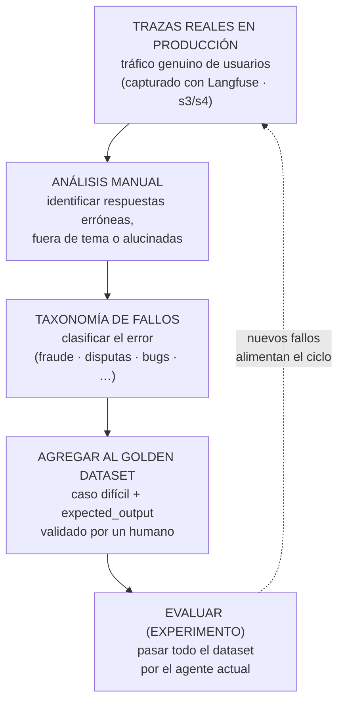

# Golden Datasets y Evaluación Continua de Agentes

> **Síntesis.** Calificar una traza suelta prueba que el agente *funcionó una vez*; para saber si un cambio en un prompt o una herramienta **mejora o empeora** el sistema hace falta una vara fija contra la cual medir siempre lo mismo. Esa vara es el **golden dataset**: una lista curada y validada por humanos de entradas (`input`) y salidas esperadas (`expected_output`) que actúa como **fuente de verdad**. No es un archivo estático sino un **organismo vivo** que crece por un ciclo de mejora continua —observar trazas reales, clasificar sus fallos en una taxonomía, agregar los casos difíciles—, de modo que el agente se evalúa siempre contra los escenarios que históricamente le costaron más. Sobre ese dataset se corren **experimentos**: ejecuciones automatizadas donde todo el conjunto pasa por el agente actual y cada respuesta se compara con la esperada mediante dos tipos de evaluador —**determinístico** (reglas de código: ¿contiene 'reembolso'?, ¿el JSON tiene la llave 'id'?) o **LLM-as-a-judge** (otro modelo juzga la intención)—. El pegamento es un **script puente** generado con Cursor y ejecutado con el SDK de Langfuse: son los "tests unitarios" del comportamiento no determinista de la IA, y su premio es poder correrlos en cada **Pull Request**.

## Introducción

Toda la semana ha ido subiendo un peldaño por vez. La sesión 3 nos enseñó a *capturar* lo que hace el agente enganchando Langfuse a un grafo de LangGraph; la sesión 4, a *leer y depurar* esas trazas de forma reactiva, bajando de una queja vaga hasta el system prompt exacto; la sesión 5, a *calificar a escala* con un LLM-juez que puntúa millones de salidas contra una rúbrica. Pero todo eso opera sobre trazas que *ya ocurrieron*: es un régimen esencialmente reactivo, que ilumina el pasado. Falta el paso proactivo —el que convierte la evaluación en una disciplina de ingeniería repetible en lugar de una autopsia caso por caso.

Esta clase da ese paso construyendo dos cosas que se sostienen mutuamente. La primera es la **fuente de verdad**: un conjunto de casos con respuesta conocida que permite responder, con un número y no con una impresión, la pregunta que define la calidad de un agente en el tiempo —"este cambio que acabo de hacer, ¿mejoró o empeoró el sistema?"—. La segunda es la **automatización** de la medición: un script que toma esa fuente de verdad, la pasa entera por el agente y devuelve una métrica de éxito, listo para incrustarse en el flujo de desarrollo habitual, idealmente disparándose en cada Pull Request como una prueba más.

El desplazamiento conceptual es grande y conviene nombrarlo desde el principio. Hasta ahora evaluábamos *lo que el agente ya había respondido en producción*; ahora vamos a evaluar *lo que responde ante un banco de pruebas fijo que nosotros controlamos*. Es la diferencia entre revisar el examen de ayer y tener un examen estándar que se le vuelve a tomar al modelo cada vez que lo tocamos. Y esa comparación con el software no es casual: lo que estamos montando es el equivalente de los tests unitarios, adaptado a un sistema cuyo comportamiento es probabilístico y no determinista.

## Objetivos de aprendizaje

1. **Definir** el concepto de *golden dataset* y su rol fundamental como fuente de verdad para medir objetivamente el impacto de los cambios en prompts y herramientas de un agente de IA.
2. **Clasificar** los errores del sistema estableciendo una taxonomía de fallos a partir del análisis manual de trazas reales de producción, para decidir qué casos difíciles ingresan al dataset.
3. **Construir** y gestionar un golden dataset en Langfuse mediante la importación de un CSV y la adición continua de interacciones reales con *Add to Dataset*.
4. **Desarrollar** un script de evaluación automatizado con el SDK de Langfuse —generado con ayuda de Cursor— que itere sobre el conjunto, conecte con la API del agente y devuelva métricas a la plataforma.
5. **Evaluar** el rendimiento del agente comparando sus respuestas con las salidas esperadas mediante evaluadores determinísticos y técnicas de LLM-as-a-judge, integrando el proceso en cada Pull Request.

## Marco conceptual

### ¿Qué es un Golden Dataset?

Un **golden dataset** (o "dataset dorado") es una **lista curada y validada por operadores humanos** de pares entrada–salida: para cada caso, una entrada representativa (`input`) y la respuesta ideal que el agente debería producir ante ella (`expected_output`). No es un volcado automático de logs ni una muestra aleatoria de tráfico: cada par ha pasado por el criterio de una persona que confirmó que la salida esperada es, efectivamente, la correcta. Esa validación humana es lo que le da autoridad y lo que justifica el adjetivo "dorado".

Su función es ser la **fuente de verdad absoluta** contra la cual se mide el rendimiento general del agente a lo largo del tiempo. La palabra clave es *tiempo*: un agente no se toca una vez y queda quieto, se itera constantemente —se ajusta un prompt, se añade una herramienta, se cambia de modelo—, y cada uno de esos cambios puede mejorar unos casos mientras rompe silenciosamente otros. Sin una referencia fija, es imposible saber en qué dirección se movió el sistema; con el golden dataset, cada modificación se somete al mismo banco de pruebas y produce un número comparable con el anterior. Es la diferencia entre "creo que quedó mejor" y "la tasa de acierto subió del 82 % al 89 %". En términos de la [sesión 2](./02-evaluation-and-observability-of-ai-agents.md), un golden dataset es lo que habilita la evaluación *con dataset*: la que dispone de un **ground truth** —la respuesta ideal esperada— y mide qué tan cerca estuvo la salida real de ese ideal.

### El ciclo de mejora continua como framework

El error más común al conocer los golden datasets es imaginarlos como un archivo estático que se escribe una vez y se archiva. La idea central de esta sesión es la contraria: un golden dataset es un **organismo vivo** que crece y se afina con el sistema al que vigila. Su valor no está en su tamaño inicial sino en su capacidad de acumular, caso por caso, la memoria de todo lo que al agente le ha costado resolver.

Ese crecimiento sigue un **ciclo de mejora continua**, un framework mental que se recorre una y otra vez. Se parte de las **trazas reales en producción** —el flujo genuino de usuarios que ya sabemos capturar (sesión 3) y navegar (sesión 4)—. Sobre ellas se hace **análisis manual** para identificar los errores: dónde el agente respondió mal, se salió del tema o alucinó. Esos errores se **clasifican en una taxonomía de fallos** que les da estructura, y de ahí se seleccionan los **casos difíciles** para **agregarlos al golden dataset** con su respuesta esperada correcta. Con el dataset enriquecido se vuelve a **evaluar**, y el ciclo recomienza. La consecuencia es poderosa: el sistema termina evaluándose de forma permanente contra los escenarios que *históricamente le han resultado más difíciles*, no contra casos fáciles inventados en un escritorio. Cada fallo de producción, una vez incorporado, se convierte en un guardián que impide que ese mismo error vuelva a colarse sin que nadie lo note —exactamente el "caso de regresión" que anticipaba el cierre de la sesión 4—.



Leído como un lazo cerrado: producción genera trazas, el análisis humano detecta sus fallos, la taxonomía los ordena, los peores ingresan al dataset con su respuesta correcta, el experimento vuelve a medir todo el conjunto, y los fallos que aún así aparezcan reinician la vuelta. El dataset nunca deja de aprender del sistema real.

### Taxonomía de fallos

El eslabón que decide *qué* entra al dataset es la **taxonomía de fallos**: un esquema de clasificación de los errores del sistema construido a partir del análisis manual de trazas reales. No basta con saber que "algo salió mal"; hay que poder decir *de qué tipo* fue el fallo, porque solo así se detectan patrones, se priorizan los más costosos y se cubren de forma balanceada al enriquecer el dataset.

Las categorías dependen del dominio del agente, y ahí está su utilidad. En un asistente financiero, por ejemplo, los cubos podrían ser **fraude** (el agente no detectó un intento de estafa), **disputas** (manejó mal un reclamo de cobro) o **bugs** (falló por un error técnico, no de criterio). Clasificar así convierte una pila informe de interacciones fallidas en un mapa accionable: si el 60 % de los fallos son de un tipo, ese es el frente que más casos difíciles debe aportar al golden dataset. La taxonomía es, en la práctica, el filtro curatorial del ciclo de mejora continua —lo que traduce "esta traza estuvo mal" en "este caso, de esta categoría, merece un puesto permanente en nuestra fuente de verdad"—.

### Evaluadores: determinísticos vs. LLM-as-a-judge

Una vez que el agente produce su respuesta ante un `input` del dataset, hay que decidir si acertó comparándola con el `expected_output`. Para ese veredicto existen dos familias de evaluador, y elegir bien entre ellas es una decisión de ingeniería, no de gusto.

Un **evaluador determinístico** aplica **reglas estrictas de código**, verificables y sin ambigüedad: ¿el string de la respuesta contiene la palabra 'reembolso'?, ¿el JSON devuelto tiene la llave 'id'?, ¿la salida coincide exactamente con la esperada? Su virtud es que es **barato, rápido y perfectamente predecible** —no hay llamadas a una API externa, no hay coste por token, y dada la misma entrada devuelve siempre el mismo resultado—. Es la herramienta ideal para todo lo **objetivo**: formato, presencia de datos concretos, estructura. Su límite es igual de nítido: no sabe nada de matices. Dos respuestas que dicen lo mismo con palabras distintas son, para una comparación de strings, tan diferentes como el día y la noche.

Ahí entra el **LLM-as-a-judge**: un segundo modelo, más avanzado, que **lee la respuesta del agente y la esperada y juzga cualitativamente** si el agente resolvió la intención del usuario, aunque lo haya hecho con otras palabras. Es la técnica que construimos en detalle en la [sesión 5](./05-llm-as-a-judge-agent-evaluation.md), donde aprendimos a diseñar el prompt del juez y —regla de oro— a exigirle **el razonamiento paso a paso ANTES de la nota numérica**, porque pedir la calificación primero ancla al modelo y degrada la evaluación. El juez es ideal para **respuestas abiertas**, donde no existe una única cadena "correcta". Su contrapartida es que es más caro, más lento y menos predecible que una regla de código.

La elección entre ambos reproduce el **tercer eje** de la [sesión 2](./02-evaluation-and-observability-of-ai-agents.md) —la naturaleza *determinística* frente a *subjetiva* del criterio— y con él su regla operativa: **si el código puede medirlo, que lo mida el código**; el LLM-juez se reserva para lo que una regla genuinamente no alcanza. En un mismo experimento conviven ambos: un evaluador determinístico verifica que la respuesta traiga el número de factura correcto, mientras un LLM-juez valora si el tono fue adecuado y si resolvió de fondo la duda.

### Experimentos, SDKs y automatización

Con el dataset como banco de pruebas y los evaluadores como jueces, el acto de medir se llama **experimento**: la **ejecución automatizada** en la que se pasa *todo* el golden dataset por el agente en su estado actual, se recogen sus respuestas y se las califica una a una. Un experimento es, por así decirlo, una foto de rendimiento del agente en un momento dado; correr dos experimentos —uno antes y otro después de un cambio— es lo que permite comparar versiones con números en lugar de intuiciones.

Lo que hace viable correr esto de forma sistemática son los **SDKs** de Langfuse (disponibles en **TypeScript** y **Python**): librerías que **automatizan** las dos tareas mecánicas del experimento —enviar cada `input` al agente y recolectar los resultados de vuelta en la plataforma—. Al reducir el experimento a un script ejecutable, los SDKs abren la puerta a su mayor ventaja: **integrarlo en el flujo de desarrollo**. El experimento puede dispararse periódicamente, o —el escenario que da ventaja competitiva real— en **cada Pull Request**, de modo que ningún cambio se fusione sin haber demostrado antes que no degrada el rendimiento contra la fuente de verdad.

Ese es exactamente el paralelo con los **tests unitarios**, pero desplazado al terreno del comportamiento no determinista. Un test unitario clásico blinda una función determinista —dada tal entrada, exige tal salida exacta— y falla el build si alguien la rompe. El experimento sobre el golden dataset hace lo mismo para un agente cuyo comportamiento es probabilístico: no exige una igualdad byte a byte, sino que la métrica de éxito no caiga por debajo de un umbral. El resultado es una red de seguridad de QA para la IA, corriendo en el mismo lugar donde ya vive la de código.

### Anatomía de un script de evaluación

Bajo el capó, ese script tiene una estructura cíclica muy reconocible, que se puede descomponer en cinco pasos ordenados:

1. **Conexión y descarga.** Una conexión inicial a la API de evaluación de Langfuse para **descargar el golden dataset** completo por su nombre, con todos sus ítems.
2. **Bucle sobre los ítems.** Un bucle que **recorre cada ítem** del dataset, cada uno con su par `input` + `expected_output`.
3. **Llamada al agente.** Por cada ítem, una **llamada a la API del agente** enviándole el `input` y esperando su respuesta —el sistema bajo prueba se ejecuta aquí igual que lo haría en producción—.
4. **Evaluación.** La **función evaluadora** que **compara la respuesta recibida con el `expected_output`**, sea con una regla determinística o con un LLM-juez, y produce un puntaje.
5. **Envío de métricas.** El **envío de los resultados de vuelta a la plataforma** (Langfuse), para que el experimento y sus métricas queden registrados y visualizables junto al resto.

La forma cerrada del patrón —descargar, iterar, ejecutar, comparar, reportar— es lo que lo hace tan reutilizable: cambia el agente, cambia el dataset, cambia la lógica del evaluador, pero el esqueleto se mantiene. Por eso conviene generarlo una vez con cuidado y reutilizarlo, y por eso también es un candidato ideal para dejar que una IA escriba el andamiaje repetitivo, que es justo lo que hará Cursor en la guía práctica.

### El rol de Langfuse y Cursor

Dos herramientas se reparten el trabajo, y conviene tener clara la frontera entre ellas. **Langfuse** cumple aquí un doble papel: es el **repositorio centralizado del dataset** —donde el golden dataset se crea, se guarda, se importa desde CSV y se enriquece con trazas reales— y es también el **dashboard visual de las métricas** de cada experimento, donde se comparan las ejecuciones y se ve la evolución del rendimiento en el tiempo. Es la misma plataforma que la semana entera ha usado para observar y evaluar, ahora en su faceta de banco de pruebas y tablero de resultados.

**Cursor**, en cambio, es un **editor de código potenciado por IA**, y su rol es puntual pero valioso: **generar rápidamente el script puente** entre la API del agente y el SDK de evaluación. Todo el andamiaje del script de evaluación —la conexión, el bucle, las llamadas, el reporte— es código repetitivo y estructurado, exactamente el tipo de tarea que un asistente de IA resuelve en segundos a partir de un buen prompt. Cursor no evalúa nada ni almacena datos; simplemente ahorra el tiempo de escribir el pegamento a mano, para que el esfuerzo humano se concentre donde importa: en curar el dataset y en diseñar los criterios de evaluación.

### ⚠️ Consideraciones importantes

Dos advertencias sostienen la fiabilidad de todo el montaje. La primera es conceptual y es la más fácil de olvidar en el entusiasmo por automatizar: hay que **mantener el criterio humano —el human-in-the-loop— en el centro**. Un golden dataset vale exactamente lo que valen sus salidas esperadas, y esas salidas solo son fuente de verdad si **personas competentes las revisaron y confirmaron**. Un dataset poblado a la ligera, con `expected_output` sin validar, no es una vara de medir sino una fuente de error que se propaga en silencio: el agente puede "acertar" contra una respuesta esperada que en realidad estaba mal. La automatización escala la medición; el humano garantiza que lo que se mide sea verdad —el mismo principio que en la sesión 5 exigía calibración humana periódica sobre el LLM-juez—.

La segunda es operativa y de seguridad: el **manejo de credenciales**. El script necesita claves sensibles —la Public Key y la Secret Key de Langfuse, y a menudo la API key del proveedor LLM que actúa de juez—, y todas deben vivir en **variables de entorno** (un archivo `.env` fuera del control de versiones), **nunca escritas directamente en el código ni expuestas en repositorios públicos**. Una Secret Key filtrada en un commit da acceso a los datos y al presupuesto de tokens de la organización. La regla es simple e innegociable: las claves se inyectan por entorno, el `.env` se ignora en Git, y ninguna credencial viaja jamás en el historial del repo.

## Guía práctica

El objetivo de esta guía es construir, de punta a punta, un experimento de evaluación: crear un golden dataset en Langfuse, generar con Cursor el script que lo recorre contra el agente, ejecutarlo y ver sus métricas, y —opcionalmente— elevar la comparación a un LLM-juez. El agente bajo prueba es el mismo de la semana, cuyo repositorio es [`lab10-org/10x-builders-agent`](https://github.com/lab10-org/10x-builders-agent).

### Preparación

1. **Inicia sesión en Langfuse** y selecciona el **proyecto** activo del agente —el mismo donde vienes capturando trazas—.
2. **Abre Cursor** y prepara un **directorio de trabajo local** vacío donde vivirá el script de evaluación.
3. En la configuración de Langfuse, ten a mano tus **claves de API**: la **Public Key** (`pk-lf-...`), la **Secret Key** (`sk-lf-...`) y el **Host**. Las necesitarás para que el script se autentique; guárdalas como cualquier credencial sensible.

### Paso 1 — Crear y gestionar el dataset en Langfuse

1. En el **panel lateral izquierdo**, entra a **Datasets** y pulsa **Create Dataset**. Dale un nombre claro (por ejemplo `mi-dataset`).
2. **Importa un CSV** con los casos iniciales. El archivo debe tener **columnas claras** que Langfuse pueda mapear a los campos del dataset: una para los **inputs** y otra para las **salidas esperadas** (`expected_output`). Este es el arranque en frío del dataset —los casos base que ya sabes que el agente debe resolver—.
3. Para **enriquecerlo con casos reales**, ve a la pestaña **Traces**, observa las interacciones genuinas de producción, **selecciona una traza problemática** —una de las que tu taxonomía de fallos marcó como difícil— y usa **Add to Dataset**. Así conviertes un fallo real, ya validado por tu criterio, en un caso permanente de la fuente de verdad. Este es el ciclo de mejora continua en acción, y depende directamente de la lectura de trazas de la sesión 4.
4. **Verifica que el dataset se pobló**: ábrelo y comprueba que la lista de ítems muestra los pares `input` / `expected_output` esperados.

### Paso 2 — Generar el script de evaluación con Cursor

1. En Cursor, abre el **chat de IA** (`Cmd/Ctrl + K`).
2. Dale un **prompt detallado** que describa el script completo. Por ejemplo: *"Crea un script usando el SDK de Langfuse que descargue mi dataset llamado 'mi-dataset', itere sobre sus ítems enviando el `input` a la API de mi agente en `http://localhost:3000/api`, y registre el resultado comparando la respuesta con la salida esperada"*.
3. Genera el código y **guárdalo** como `evaluacion.ts` (o `evaluacion.py` si trabajas en Python). La estructura generada seguirá la anatomía de cinco pasos y se parecerá a esto:

   ```ts
   const dataset = await langfuse.getDataset("mi-dataset");
   for (const item of dataset.items) {
     const agenteRespuesta = await llamarAgente(item.input);
     const esCorrecto = agenteRespuesta === item.expectedOutput;
     // Enviar resultado a Langfuse
   }
   ```

4. **Verifica y ajusta a mano** lo que la IA no puede adivinar: sobre todo la **URL real de la API del agente** y los **nombres de las variables** (que el `item.input` y el `item.expectedOutput` coincidan con cómo tu dataset y tu agente nombran las cosas). El código generado es un andamiaje, no un producto terminado —revisarlo es parte del trabajo, no un lujo—.

### Paso 3 — Ejecutar el experimento en la terminal

1. En la raíz del proyecto, crea un archivo **`.env`** con las credenciales de Langfuse, y asegúrate de que esté en tu `.gitignore`:

   ```text
   LANGFUSE_PUBLIC_KEY=pk-lf-...
   LANGFUSE_SECRET_KEY=sk-lf-...
   LANGFUSE_HOST=https://cloud.langfuse.com
   ```

2. Abre la **terminal integrada** de Cursor y ejecuta el script con el comando de tu entorno:

   ```bash
   npx ts-node evaluacion.ts
   ```

   (o el equivalente de tu stack, por ejemplo `python evaluacion.py`).
3. **Observa el procesamiento**: verás el script descargar el dataset, recorrer los ítems, llamar al agente por cada uno y reportar sus resultados.
4. Vuelve a Langfuse y abre la pestaña **Experiments**: ahí aparecerá la **nueva ejecución** con sus **métricas** agregadas —la tasa de acierto y el detalle por ítem—. Ese número es tu línea base: el próximo cambio en el agente se medirá contra él.

### Paso 4 (opcional) — Integrar LLM-as-a-judge

1. En la función de evaluación, **reemplaza la comparación estricta de texto** (`agenteRespuesta === item.expectedOutput`) por una **llamada a un LLM** —OpenAI o el proveedor que prefieras—.
2. Diseña un **prompt evaluador** que reciba tanto el `expected_output` como la respuesta del agente y devuelva una **puntuación de 0 a 1 por precisión semántica** —qué tan bien resolvió la intención, más allá de las palabras exactas—. Aplica aquí la **regla de oro de la [sesión 5](./05-llm-as-a-judge-agent-evaluation.md)**: exige al juez que **razone paso a paso ANTES de emitir la nota**, para que la puntuación sea la conclusión de un análisis y no un impulso racionalizado después.
3. **Ajusta el registro en Langfuse** para enviar esa puntuación cualitativa como el score del experimento, y **re-ejecuta**. Ahora tu experimento mide semántica, no coincidencia literal —el mismo agente, evaluado con una vara mucho más justa para respuestas abiertas—.

## Síntesis

Con esta sesión, el arco de la semana se cierra en un círculo completo y operativo. Vimos *por qué* evaluar y *qué* evaluar (sesiones 1 y 2), aprendimos a **capturar** las trazas (sesión 3), a **leerlas y depurarlas** de forma reactiva (sesión 4) y a **calificarlas a escala** con un LLM-juez (sesión 5). Todo eso, sin embargo, actuaba sobre el pasado. El golden dataset es la pieza que lo vuelve futuro: toma esas trazas reales, filtra las difíciles a través de una **taxonomía de fallos**, las convierte en una **fuente de verdad** validada por humanos, y sobre ella corre **experimentos** que —con evaluadores determinísticos para lo objetivo y LLM-jueces para lo subjetivo, orquestados por un script puente que Cursor ayuda a escribir y el SDK de Langfuse ejecuta— producen una métrica de éxito comparable en el tiempo. Así, *ver* (observabilidad), *entender* (depuración) y *calificar* (el juez) dejan de ser actos aislados y se integran en un **proceso de QA repetible que se dispara en cada cambio**, idealmente en cada Pull Request. La observabilidad captura, la evaluación juzga, y el golden dataset convierte cada fallo de ayer en el guardián de mañana: la ingeniería de IA confiable no es un examen que se pasa una vez, sino un banco de pruebas que crece con el sistema.

## Preguntas de repaso

1. ¿Qué distingue a un *golden dataset* de un simple volcado de logs de producción, y por qué la validación humana de cada `expected_output` es lo que lo convierte en fuente de verdad? ¿Qué pregunta concreta sobre un cambio permite responder que la evaluación caso por caso no puede?
2. Explica por qué se dice que el golden dataset es un "organismo vivo" y no un archivo estático. Recorre las etapas del ciclo de mejora continua y explica qué papel cumple la taxonomía de fallos en decidir qué casos ingresan.
3. Tienes que evaluar dos cosas de la respuesta de un agente: (a) que el JSON devuelto contenga la llave `id`, y (b) que la respuesta resuelva de fondo la intención del usuario aunque use otras palabras. ¿Cuál delegarías a un evaluador determinístico y cuál a un LLM-as-a-judge, y por qué? ¿Con qué eje de la sesión 2 se corresponde esa decisión?
4. Define qué es un *experimento* sobre un golden dataset y describe los cinco pasos de la anatomía de su script. ¿En qué sentido es análogo a los "tests unitarios" y en qué se diferencia por tratarse de comportamiento no determinista?
5. ¿Cómo se reparten Langfuse y Cursor el trabajo en este flujo? Nombra qué hace cada uno y por qué el script de evaluación es un buen candidato para generarse con una IA.
6. Un compañero afirma: "automaticé todo el experimento, así que ya no necesito humanos en el proceso". ¿Qué dos consideraciones importantes de esta sesión —una conceptual y una de seguridad— desmienten o matizan esa afirmación?

## Recursos

- [Langfuse — Datasets (overview)](https://langfuse.com/docs/datasets/overview) — documentación oficial sobre qué son los datasets en Langfuse, cómo se estructuran en ítems (`input` / `expected_output`) y cómo funcionan como fuente de verdad para evaluar el agente frente a cambios en el tiempo.
- [Langfuse — Dataset Runs / Experiments (get started)](https://langfuse.com/docs/datasets/get-started) — guía práctica para ejecutar un experimento con el SDK: descargar el dataset, iterar sus ítems, enviar cada `input` al agente y registrar los resultados como una *dataset run* visible en la pestaña Experiments.
- [`lab10-org/10x-builders-agent`](https://github.com/lab10-org/10x-builders-agent) — repositorio del agente que se evalúa en esta sesión; expone la API contra la que el script de evaluación envía cada `input` del dataset.
- [Cursor](https://cursor.sh) — editor de código potenciado por IA usado para generar rápidamente el script puente entre la API del agente y el SDK de evaluación de Langfuse.
- Conexión interna: [Evaluación y Observabilidad de Agentes de IA](./02-evaluation-and-observability-of-ai-agents.md) — la sesión 2, que definió los ejes *con/sin dataset* y *determinística/subjetiva* y presentó el ciclo de mejora continua; este golden dataset es la implementación concreta de la evaluación *con dataset* y de ese ciclo.
- Conexión interna: [Integración de Langfuse en Agentes de LangGraph](./03-langfuse-integration-langgraph-agents.md) — la sesión 3, que instrumentó la captura de trazas; esas trazas son la materia prima cruda de la que, tras análisis manual, salen los casos que enriquecen el dataset.
- Conexión interna: [Tracing y Observabilidad de Agentes de IA con Langfuse](./04-langfuse-tracing-reactive-debugging.md) — la sesión 4, que enseñó a leer y depurar trazas; es la habilidad que permite elegir *qué* traza problemática añadir al dataset con *Add to Dataset*.
- Conexión interna: [Evaluación de Agentes con LLM as a Judge](./05-llm-as-a-judge-agent-evaluation.md) — la sesión 5, que construyó el LLM-juez y su regla de razonamiento-antes-de-nota; aquí ese mismo juez se reutiliza como evaluador semántico dentro del script de evaluación.
