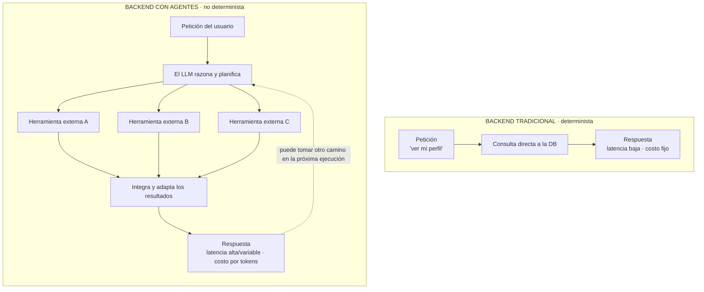

# Deployment Fundamentals for AI Agents

> **Síntesis.** **Desplegar** (deployment) es sacar el agente de tu máquina local y ponerlo en un servidor accesible desde Internet; un entorno de producción real se reconoce por dos rasgos: una **base de datos persistente** alojada en la nube y una **URL pública** que sirve de puerta de enlace al mundo. Pero un backend de agentes no se comporta como uno tradicional. La analogía que ordena la clase lo resume: un backend clásico es una cadena de **comida rápida** —determinista, con latencia baja y predecible y costos fijos, sabes qué obtienes y cuánto tarda—, mientras que un backend con agentes es una **cocina de autor** donde el chef —el **LLM**— decide en vivo, llama a herramientas externas y adapta cada plato, con **latencia alta y variable**, **costos dinámicos por tokens** y salidas **no deterministas**. Esa imprevisibilidad vuelve **crítica la observabilidad**: sin ella el agente en producción es una **caja negra** donde un fallo, una alucinación o una mala decisión quedan sin explicación. Y para alojarlo, el abanico de proveedores va de **AWS** —robusto y configurable, pero complejo— a plataformas developer-friendly como **Railway** o **Render** —subes el código y obtienes servidor, base de datos y URL casi sin fricción—.

## Introducción

Toda la semana anterior giró en torno a *ver* y *juzgar* lo que hace un agente: aprendimos por qué el monitoreo clásico no basta, cómo capturar las trazas con Langfuse, cómo leerlas para depurar y cómo evaluarlas a escala con un LLM juez. Esa capacidad no era un fin en sí mismo, sino la preparación para el paso que abre esta clase: **llevar el agente a producción**. Y "producción" no significa "que funcione en mi laptop", sino que corra en un servidor de Internet, con una dirección pública por la que cualquier usuario o sistema externo pueda hablarle y una base de datos duradera que conserve la información entre reinicios.

El problema es que desplegar un agente no se parece a desplegar un backend cualquiera. Un servidor web tradicional es un mundo predecible: recibe una petición, consulta una base de datos, devuelve una respuesta, y lo hace de la misma forma, al mismo costo y en el mismo tiempo cada vez. Un agente introduce un LLM en el centro de la ejecución, y con él llegan tres cambios de paradigma —en la latencia, en los costos y en el determinismo— que obligan a pensar el despliegue con estrategias distintas. De ahí que la observabilidad, que la semana 7 trató como una buena práctica, aquí se vuelva un **requisito**: en producción, sobre tráfico real e impredecible, no poder ver por dónde razonó el agente es quedarse ciego justo cuando más se necesita mirar.

Esta es una clase puramente conceptual —no hay herramientas que instalar ni pasos que ejecutar— y sienta las bases del trabajo práctico de las próximas sesiones. Su meta es que, antes de tocar una sola plataforma de despliegue, entiendas *por qué* un agente exige tratamiento especial, *qué* define un entorno de producción y *entre qué opciones* elegirás para publicarlo.

## Objetivos de aprendizaje

1. **Definir** qué significa llevar un agente de IA a producción y cuáles son los dos rasgos que caracterizan un entorno de producción real.
2. **Comparar** el rendimiento, los costos y el nivel de determinismo entre un backend tradicional y uno basado en agentes.
3. **Explicar** por qué la naturaleza impredecible de los LLMs vuelve indispensable integrar observabilidad y evaluación en el despliegue.
4. **Diferenciar** las características y los casos de uso de los proveedores de nube robustos frente a las plataformas de despliegue simplificadas.
5. **Reconocer** cómo estos fundamentos teóricos condicionan la configuración práctica del entorno de producción en las siguientes sesiones.

## Marco conceptual

### ¿Qué significa llevar un agente a producción?

**Desplegar** (*deployment*) es el acto de trasladar un proyecto desde el **entorno de desarrollo local** —tu propia máquina, donde el agente corre para que tú lo pruebes— hacia un **servidor accesible en Internet**, donde queda disponible para el resto del mundo. Mientras el agente vive solo en tu portátil, no existe para nadie más: se apaga cuando cierras el proceso y sus datos desaparecen con él. Producción es exactamente lo contrario: el agente corre de forma continua en infraestructura remota y cualquiera con la dirección correcta puede interactuar con él.

Un entorno de producción real se reconoce por **dos características** que lo separan de un experimento local. La primera es una **base de datos persistente y duradera** alojada en la nube: un almacén que guarda la información —conversaciones, memoria, estado del usuario— de forma segura y que sobrevive a los reinicios del servidor, a diferencia de los datos efímeros que se pierden al detener un proceso local. La segunda es una **URL o dominio público**: la puerta de enlace que hace al agente alcanzable desde cualquier parte. Esa dirección es la que permite que usuarios finales, aplicaciones cliente u otros sistemas envíen peticiones a la API del agente sin saber nada de dónde ni cómo corre por dentro. Sin base de datos persistente el agente no recuerda; sin URL pública, nadie puede llegar a él. Producción es la conjunción de ambas.

### La analogía del restaurante: comida rápida vs. cocina de autor

Para captar por qué desplegar un agente no es como desplegar un backend cualquiera conviene pensar en dos tipos de restaurante. Un backend tradicional es una **cadena de comida rápida** —piensa en un McDonald's—: sus procesos están **altamente estandarizados**, de modo que sabes de antemano qué vas a recibir, cuánto te va a costar y cuánto vas a esperar. Pides un combo por su número y el resultado es idéntico hoy, mañana y en cualquier local. Esa previsibilidad no es un defecto: es precisamente la virtud de un sistema determinista.

Un backend basado en agentes, en cambio, es una **cocina de autor**. Aquí el **chef** —que en nuestra analogía es el **LLM**— no ejecuta un guion fijo, sino que **toma decisiones creativas** para cada comensal: interpreta lo que el cliente pidió, echa mano de **diversas herramientas externas en tiempo real** —consulta despensas, combina ingredientes, ajusta técnicas— y **adapta el resultado** a esa petición específica. El plato que sale es más rico y más a medida, pero también más **complejo y menos predecible**: dos comensales con el mismo pedido pueden recibir preparaciones distintas, y ni el tiempo ni el costo son fijos de antemano. Esta imagen es la brújula del resto de la clase; cada diferencia técnica que veremos a continuación es una consecuencia de haber cambiado la línea de ensamblaje por el criterio de un chef.

### El backend tradicional en el mundo real

Bajemos la analogía a un caso concreto. Las aplicaciones web y móviles clásicas —un sistema de inventario, una red social básica, un portal de reservas— funcionan de forma **determinística**: la misma entrada produce siempre la misma salida. Cuando un usuario pulsa "ver mi perfil", el servidor recibe la petición, consulta la base de datos por ese registro y devuelve la información casi **instantáneamente**. No hay deliberación ni ambigüedad; es una consulta directa con una única respuesta correcta.

De ese comportamiento se derivan tres rasgos que definen al backend tradicional. Su **latencia** es **baja y muy predecible**, porque la ruta desde la petición hasta la respuesta es corta y siempre la misma. Sus **costos** son **fijos o fácilmente calculables**, ya que el trabajo por petición no varía y se puede dimensionar la infraestructura con precisión. Y sus resultados son **deterministas**: ante la misma petición, la misma respuesta, sin sorpresas. Esta trinidad —rápido, barato y predecible— es lo que durante décadas hizo que "el servidor responde" fuera casi sinónimo de "el sistema funciona".

### Particularidades del backend con agentes

Al introducir agentes y LLMs en el centro de la ejecución, ese paradigma se rompe en sus tres ejes. La **latencia** pasa a ser **variable y generalmente alta**: el modelo no hace una consulta directa, sino que debe **"pensar"** —razonar sobre la petición—, **planificar** una secuencia de pasos y **ejecutar llamadas a múltiples herramientas externas**, cada una con su propio tiempo de espera. Una respuesta que en un backend clásico tardaría milisegundos, aquí puede tardar segundos, y cuánto exactamente depende de lo que el agente decida hacer.

Los **costos** dejan de ser fijos para volverse **dinámicos**: dependen de la complejidad de la tarea y del **consumo de tokens** de cada interacción. Una consulta trivial gasta poco; una que obligue al modelo a razonar largo y a encadenar varias herramientas gasta mucho más. El presupuesto ya no se calcula por número de peticiones, sino por el trabajo cognitivo que cada una detona. Y lo más disruptivo: las salidas son **completamente no deterministas**. La misma consulta puede generar respuestas distintas —o incluso **caminos de ejecución distintos**, con herramientas diferentes en distinto orden— en momentos diferentes. Esto no es un error a corregir, sino la naturaleza del sistema: es el chef improvisando, no la máquina repitiendo. La tabla y el diagrama siguientes resumen ese contraste.

| Dimensión | Backend tradicional | Backend con agentes |
|---|---|---|
| **Analogía** | Comida rápida (McDonald's) | Cocina de autor |
| **Latencia** | Baja y muy predecible | Alta y variable (el modelo piensa, planifica y llama herramientas) |
| **Costos** | Fijos o fácilmente calculables | Dinámicos: dependen de la complejidad y del consumo de tokens |
| **Determinismo** | Determinista: misma entrada → misma salida | No determinista: misma entrada → respuestas o caminos distintos |
| **Ejemplo** | "Ver mi perfil" → consulta a la DB → respuesta inmediata | Consulta → el LLM razona → llama herramientas → adapta → respuesta |

Leídos juntos, tabla y diagrama muestran la misma idea desde dos ángulos: donde el backend tradicional dibuja una **línea recta y corta** —petición, base de datos, respuesta—, el backend con agentes dibuja un **árbol ramificado** que se abre en el momento en que el LLM decide, se multiplica en llamadas a herramientas y se recompone en una respuesta adaptada. Esa ramificación es, a la vez, la fuente de su potencia y la razón de su latencia alta, su costo variable y su no-determinismo.

### Observabilidad y evaluación: evitar la caja negra

Si el backend de agentes es una cocina de autor impredecible, entonces vigilar lo que ocurre dentro de la cocina deja de ser opcional y se vuelve **crítico**. Por su naturaleza no determinista y compleja, un agente desplegado sin instrumentación es una **caja negra**: entra una petición, sale una respuesta, y todo lo que pasó en medio es invisible. El problema salta a la vista en cuanto algo va mal: si el agente **falla**, **alucina** o **toma una mala decisión**, el desarrollador no tiene forma de saber **por qué** ni **en qué paso** se equivocó —¿fue el razonamiento?, ¿la herramienta que eligió?, ¿el prompt que recibió?—. En un sistema determinista podrías reproducir el fallo; en uno no determinista, si no lo capturaste cuando ocurrió, quizá no vuelvas a verlo igual.

La respuesta a ese riesgo es integrar **observabilidad** y **evaluación**. La observabilidad permite **monitorear cada paso del razonamiento del agente**, las herramientas que invocó y los tiempos de respuesta de cada tramo, convirtiendo la caja negra en un proceso inspeccionable. Esto es exactamente lo que construimos durante toda la semana 7: las **trazas**, la instrumentación con Langfuse, la lectura del árbol de ejecución y la evaluación de las salidas a escala. Lo que allí presentamos como buena disciplina de ingeniería, el despliegue lo convierte en **indispensable**: en producción, sobre usuarios reales y con dinero de por medio en cada token, la observabilidad es lo que hace posible el **control y la mejora continua**. La semana 7 enseñó *cómo* iluminar la caja; esta clase explica *por qué*, una vez en producción, no hacerlo deja de ser una carencia menor para convertirse en una negligencia.

### Proveedores de nube: AWS vs. Railway/Render

Con el *qué* y el *por qué* claros, queda el *dónde*. Para desplegar un agente hay que alojarlo en algún **proveedor de nube** (*cloud provider*), y las opciones se ordenan en un espectro que va del control máximo a la simplicidad máxima. En un extremo están las plataformas **robustas, complejas y altamente configurables**, cuyo referente es **Amazon Web Services (AWS)**. AWS ofrece **control granular** sobre cada pieza de la infraestructura —redes, servidores, almacenamiento, escalado—, lo que la hace enormemente potente, pero a cambio **exige conocimientos avanzados** de infraestructura: hay que ensamblar y configurar manualmente muchas de las partes que en otras plataformas vienen resueltas.

En el otro extremo están las plataformas **developer-friendly** como **Railway** o **Render**, pensadas para simplificar el proceso al máximo. Con ellas el flujo se reduce prácticamente a **subir el código** para obtener de forma **automática** las tres piezas que definen producción: un **servidor** donde corre el agente, una **base de datos** persistente y una **URL pública** para alcanzarlo. Todo bajo un modelo ágil de **pago por consumo**, en el que se factura por los recursos realmente usados. El trade-off es nítido y conviene tenerlo presente al elegir: AWS entrega **control** a cambio de **complejidad**, mientras que Railway y Render entregan **simplicidad** a cambio de ceder parte de ese control fino. Para un equipo que quiere publicar rápido un agente y validar su comportamiento en producción, la balanza suele inclinarse hacia las plataformas simplificadas.

### Preparándonos para el despliegue práctico

Todo lo anterior es teoría, pero es la teoría que **dicta las decisiones prácticas** de las próximas sesiones. Entender que la latencia de un agente es alta y variable influye en cómo se configuran tiempos de espera y expectativas de respuesta; entender que los costos crecen con los tokens obliga a dimensionar el presupuesto de otra manera; y entender que la observabilidad es vital determina qué se instrumenta **antes** de abrir el agente al público, no después. En otras palabras, los tres cambios de paradigma —latencia, costos, no-determinismo— no son curiosidades académicas: son los parámetros con los que se configura el entorno de producción.

En los próximos módulos daremos el salto de lo conceptual a lo concreto: tomaremos el código de nuestro agente y ejecutaremos, **paso a paso**, su despliegue en una plataforma amigable como **Railway** o **Render**, para terminar con nuestra propia **URL pública** y una **base de datos en la nube** funcionando. Esta clase es el mapa mental que hará que esos pasos tengan sentido en lugar de ser una receta a ciegas.

## Síntesis

La semana 7 nos enseñó a **observar y evaluar**; esta clase abre la semana 8 con el paso que le da sentido: **poner en producción**. Desplegar un agente es trasladarlo de tu máquina a un servidor de Internet, y "producción" se define por dos anclas —una **base de datos persistente** y una **URL pública**—. Pero el corazón de la clase es una advertencia: el backend de un agente no es el de una aplicación tradicional. Donde la comida rápida ofrece latencia baja, costos fijos y determinismo, la cocina de autor del LLM ofrece latencia alta y variable, costos dinámicos por tokens y salidas no deterministas. Esa imprevisibilidad es precisamente la que convierte la **observabilidad** en un **requisito de despliegue y no en un lujo**: un agente en producción que no se puede observar es una caja negra que, cuando falle, fallará sin dejar rastro de por qué. Por eso lo que la semana pasada aprendimos a construir —trazas, Langfuse, evaluación— es exactamente lo que el despliegue vuelve imprescindible. Con ese marco claro, y sabiendo que el abanico de proveedores va de la potencia compleja de AWS a la simplicidad de Railway y Render, quedamos listos para el despliegue práctico que sigue.

## Preguntas de repaso

1. ¿Qué significa exactamente "llevar un agente a producción" y cuáles son las **dos características** que distinguen un entorno de producción real de un entorno de desarrollo local? Explica qué aporta cada una.
2. Desarrolla la **analogía del restaurante**: ¿qué representa la cadena de comida rápida y qué la cocina de autor? Usa la analogía para explicar por qué cambian la latencia, los costos y el determinismo al pasar de un backend tradicional a uno con agentes.
3. Un compañero afirma: "puedo calcular el costo mensual de mi agente multiplicando el número de peticiones por un precio fijo, como en mi backend anterior". ¿Por qué es incorrecto ese razonamiento en un backend con agentes?
4. ¿Por qué la **observabilidad** es crítica —y no meramente conveniente— en un agente en producción? Explica qué significa que el agente sea una **caja negra** y qué se pierde cuando falla o alucina sin instrumentación.
5. Describe el **trade-off** entre **AWS** y plataformas como **Railway/Render**. ¿En qué situación elegirías cada una y qué gana y qué cede quien opta por la opción developer-friendly?

## Recursos

- [Railway](https://railway.com) — plataforma de despliegue *developer-friendly*: subes el código y obtienes automáticamente servidor, base de datos persistente y URL pública, bajo un modelo de pago por consumo. Su [documentación oficial](https://docs.railway.com) es la referencia base del despliegue práctico de las próximas sesiones.
- [Render](https://render.com) — alternativa igualmente *developer-friendly* a Railway: aloja servicios web, bases de datos y sitios con un flujo de despliegue simplificado a partir del repositorio de código.
- [Amazon Web Services (AWS)](https://aws.amazon.com) — el referente de nube **robusta, potente y altamente configurable**: ofrece control granular sobre toda la infraestructura a cambio de exigir conocimientos avanzados para configurarla.
- Conexión interna: [Observabilidad y Evaluación en Sistemas de Inteligencia Artificial](../week-07/01-observability-and-evaluation-in-ai-systems.md) — la sesión 1 de la semana 7, que estableció el marco de observabilidad y evaluación y el concepto de **fallas silenciosas**; es la razón de fondo por la que un agente en producción no puede permitirse ser una caja negra.
- Conexión interna: [Integración de Langfuse en Agentes de LangGraph](../week-07/03-langfuse-integration-langgraph-agents.md) — la sesión 3 de la semana 7, que instrumentó el paso de **caja negra a caja blanca** con Langfuse; esa es exactamente la capacidad que el despliegue vuelve indispensable.
