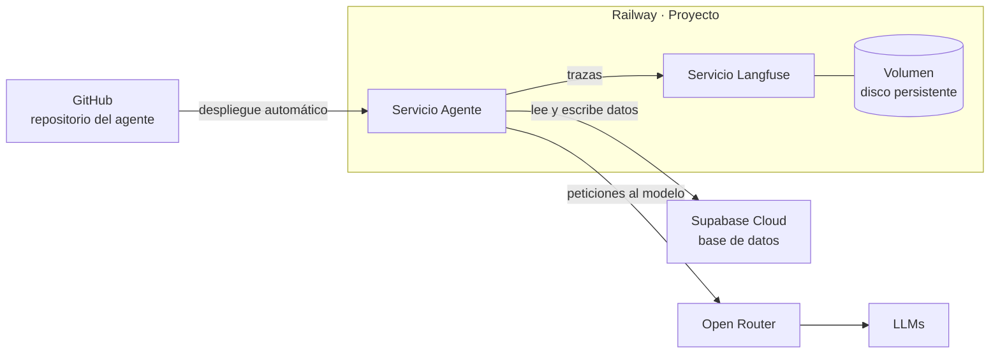
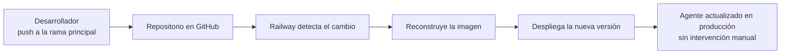

# Despliegue y Topología en Railway

> **Síntesis.** Llevar el agente a producción en una **Plataforma como Servicio (PaaS)** como **Railway** no consiste en "subir código a un servidor", sino en tener un **mapa mental** claro de qué piezas existen y cómo se conectan: dentro de Railway, un **Proyecto** que agrupa **Servicios** (el agente y Langfuse) y **Volúmenes** que dan persistencia al disco; fuera de Railway, **Supabase Cloud** como base de datos y **OpenRouter** como puerta de acceso a los LLMs. A ello se suma la **observabilidad** con Langfuse, que evita que el agente opere como caja negra, y un **despliegue continuo** que conecta GitHub con Railway para que cada mejora llegue a producción sin intervención manual.

## Introducción

La clase anterior definió qué es producción —una base de datos persistente y una URL pública— y explicó por qué un agente, con su latencia variable, sus costos por tokens y sus salidas no deterministas, exige observabilidad desde el primer día. Quedaba pendiente el *dónde* y el *cómo*: en qué plataforma corre el agente, qué componentes necesita a su alrededor y de qué manera una actualización de código termina convertida en una versión en vivo. Esta sesión responde a eso con un plano de conjunto antes de tocar ninguna herramienta.

Es una clase conceptual de corta duración (unos seis minutos de video) cuyo valor es preparatorio: funciona como el paso previo a "ensuciarnos las manos" en las siguientes sesiones prácticas, donde se crearán las cuentas en Railway y Supabase y se configurará Langfuse. Las herramientas que aparecen —Railway, Supabase Cloud, OpenRouter, GitHub y Langfuse— se presentan aquí solo por su rol dentro de la arquitectura. El prerrequisito es haber completado los módulos previos de desarrollo y pruebas del agente en local, porque lo que ahora se despliega es justamente ese agente.

## Objetivos de aprendizaje

1. **Comparar** las ventajas de una PaaS como Railway frente a la infraestructura tradicional para desplegar agentes con agilidad.
2. **Explicar** la función de los Proyectos, los Servicios y los Volúmenes en Railway y cómo se jerarquizan.
3. **Identificar** por qué la persistencia en disco importa frente al almacenamiento efímero de la nube.
4. **Describir** la topología de producción que integra Railway, Supabase Cloud, OpenRouter y Langfuse.
5. **Esquematizar** el flujo de integración y despliegue continuo entre GitHub y Railway, y **justificar** el uso de Langfuse en producción.

## Marco conceptual

### Railway y el modelo PaaS

Una **Plataforma como Servicio** (*Platform as a Service*, PaaS) es un tipo de proveedor de nube que se hace cargo de la infraestructura subyacente para que el desarrollador se ocupe solo de su aplicación. **Railway** es una plataforma de este tipo y su propuesta es simplificar radicalmente el paso a producción: automatiza la infraestructura de base, la configuración de dominios públicos y las redes internas por las que se comunican los componentes. Lo único que el desarrollador debe aportar es el **código fuente** o una **imagen de Docker** (un paquete autocontenido que incluye la aplicación y todo lo necesario para ejecutarla); de lo demás se encarga la plataforma.

La consecuencia práctica es un cambio de foco. En lugar de dedicar tiempo a mantener servidores, el esfuerzo se concentra en la lógica del agente: sus herramientas, sus prompts, su comportamiento. Esa es la razón por la que las plataformas de este estilo resultan tan atractivas para iterar rápido, y es el hilo que retomaremos al compararla con AWS. Antes, conviene entender cómo organiza Railway lo que despliega.

### Anatomía de Railway: Proyectos, Servicios y Volúmenes

Railway estructura todo con tres conceptos, y una analogía los ordena bien: un **edificio de oficinas moderno**. El **Proyecto** es el edificio entero, un contenedor lógico que reúne todo lo que pertenece a una misma "empresa", que en nuestro caso es el agente de IA y lo que lo rodea. Los **Servicios** son las oficinas individuales dentro del edificio: cada una es un destino donde se despliega y ejecuta un código, por ejemplo una oficina para el agente principal y otra para el sistema de monitoreo. Los **Volúmenes** son los archiveros físicos dentro de esas oficinas, donde se guardan los documentos importantes para que no se pierdan cuando la oficina se cierra al final del día.

| Concepto en Railway | Analogía | Función |
|---|---|---|
| **Proyecto** | El edificio entero | Contenedor lógico que agrupa todos los componentes de una misma aplicación o sistema |
| **Servicio** | Cada oficina del edificio | Destino donde se despliega y ejecuta un código (el agente, el sistema de monitoreo) |
| **Volumen** | El archivero dentro de la oficina | Disco persistente adjunto a un servicio para que sus archivos sobrevivan a reinicios |

La relación es jerárquica: un proyecto contiene varios servicios y cada servicio puede tener adjunto un volumen. Lo que sigue es ver qué servicios concretos viven en ese edificio y cuáles quedan fuera de él.

### Topología de producción del agente

Un agente en producción no vive aislado, y por eso hablamos de **topología**: el mapa de qué componentes existen y cómo se comunican entre sí. En nuestra arquitectura, Railway aloja **dos servicios** dentro del mismo proyecto: el **Agente** y **Langfuse**, la herramienta de observabilidad. Hacia afuera, el agente se conecta a dos servicios externos: **Supabase Cloud**, que actúa como su base de datos, y **OpenRouter**, que provee acceso a los **Modelos de Lenguaje Grande** (LLMs) a través de una sola puerta. Esa red de conexiones es la que permite al agente consultar datos, tomar decisiones y registrar todo lo que hace.

El diagrama muestra cuatro flujos distintos. GitHub alimenta el despliegue del agente; el agente consulta y escribe en Supabase; el agente envía sus peticiones de lenguaje a OpenRouter, que las encamina a los LLMs; y, en paralelo, el agente reporta cada paso de su ejecución a Langfuse en forma de trazas. La frontera del recuadro de Railway es la clave de lectura: lo que está dentro lo administramos como servicios de nuestro proyecto, y lo que está fuera es un proveedor especializado al que nos conectamos. El volumen aparece junto a Langfuse, pero es un mecanismo general que puede adjuntarse a cualquier servicio, como veremos a continuación.

### Persistencia de datos: el problema del almacenamiento efímero y los Volúmenes

En la nube, el almacenamiento por defecto es **efímero**: si un servicio se reinicia o se apaga, cualquier archivo guardado en su disco virtual se pierde para siempre. En un servidor de pruebas esto pasa casi inadvertido, pero para nuestro agente es un problema crítico, porque utiliza herramientas que **modifican archivos de forma constante**. Sin ninguna medida, cada reinicio dejaría al agente con su "memoria en disco" vacía, como si empezara de cero.

Los **Volúmenes** de Railway resuelven exactamente eso: son **discos persistentes** que se adjuntan a un servicio y garantizan que la memoria y los archivos del agente sobrevivan a cualquier reinicio. Retomando la analogía, el servicio es la oficina que se cierra cada noche y el volumen es el archivero que se queda con los documentos intactos para el día siguiente. Conviene no confundir este mecanismo con la base de datos externa: Supabase guarda la información estructurada del agente fuera de Railway, mientras que el volumen conserva los archivos que viven en el disco del propio servicio.

### Integración y despliegue continuo con GitHub

Subir el código a mano cada vez que mejoramos algo sería lento y propenso a errores. Para evitarlo se implementa **integración y despliegue continuo** (*CI/CD*): un flujo en el que un cambio de código aprobado se convierte en una versión desplegada sin pasos manuales. En nuestro caso basta con **vincular un servicio de Railway con un repositorio de GitHub**, lo que crea un puente automático entre el lugar donde vive el código y el lugar donde corre.

A partir de ese vínculo, el ciclo es siempre el mismo: cada vez que hacemos un **push a la rama principal**, Railway detecta el cambio, reconstruye la imagen y despliega la nueva versión del agente en producción sin que tengamos que presionar un solo botón.

Lo valioso de este flujo es que convierte el despliegue en un efecto secundario del trabajo normal de desarrollo: la rama principal pasa a ser la fuente de verdad de lo que corre en producción. Para decidir si esta comodidad compensa, es útil contrastarla con el extremo opuesto del espectro de proveedores.

### AWS vs. Railway

**AWS** ofrece **control granular absoluto** sobre cada pieza de la infraestructura, pero ese control tiene un precio: hay que configurar manualmente redes (**VPCs**, redes virtuales privadas), balanceadores de carga, políticas de seguridad y servidores (**EC2**, las máquinas virtuales de AWS). Todo ello exige conocimientos profundos de DevOps. Railway abstrae esa complejidad y entrega el resultado ya ensamblado, a costa de ceder parte del control fino.

| Aspecto | AWS | Railway |
|---|---|---|
| **Enfoque** | Infraestructura con control granular absoluto | PaaS que abstrae la infraestructura |
| **Redes, balanceadores y seguridad** | Se configuran manualmente (VPCs, balanceadores de carga, políticas de seguridad) | La plataforma gestiona dominios públicos y redes internas |
| **Servidores** | Se aprovisionan y administran (EC2) | No se gestionan; se aporta código o una imagen de Docker |
| **Conocimiento requerido** | Profundo en DevOps | Mínimo de infraestructura |
| **Caso ideal** | Sistemas que requieren control total de la arquitectura | Iterar y desplegar agentes de IA con rapidez |

La analogía que resume la diferencia es esta: **en AWS construyes la carretera y el auto; en Railway te subes a manejar**. Ambas llevan al destino, pero solo una te deja concentrarte en conducir. Para un equipo cuyo objetivo es publicar un agente y validar su comportamiento real, ese ahorro de construcción es lo que hace a Railway ideal para iterar rápido.

### Observabilidad y relación con el curso

Falta explicar por qué **Langfuse** figura como un servicio propio dentro de la topología y no como un añadido opcional. La razón es que un agente en producción sin observabilidad es una **caja negra**: recibe peticiones, devuelve respuestas y nadie sabe qué ocurrió en medio. Al desplegar Langfuse como su propia "oficina" dentro del proyecto, el agente tiene un destino permanente al que enviar las trazas de todo lo que hace —cada decisión, cada llamada a una herramienta—, y el equipo tiene un lugar desde donde monitorear y evaluar su comportamiento con datos reales.

Este mapa es el paso preparatorio antes de las clases prácticas, donde se crearán las cuentas en Railway y Supabase y se configurará Langfuse. Entender la topología de antemano hace que cada configuración tenga sentido como pieza de un sistema, y garantiza que la observabilidad se diseñe junto con el despliegue en lugar de añadirse cuando ya hay un fallo que no se puede explicar.

## Síntesis

El salto de local a producción se apoya en un modelo mental más que en un conjunto de comandos. Railway, como PaaS, absorbe la complejidad de la infraestructura y deja al desarrollador con tres conceptos: el **Proyecto** que lo agrupa todo, los **Servicios** donde corre cada código y los **Volúmenes** que evitan que el disco efímero se lleve los archivos del agente. Alrededor de ese núcleo se conectan proveedores especializados —Supabase Cloud para los datos, OpenRouter para los LLMs— y Langfuse como servicio de observabilidad que mantiene al agente fuera de la caja negra. GitHub cierra el círculo: con cada push a la rama principal, Railway reconstruye y despliega sin intervención manual. Frente a la potencia pero también la complejidad de AWS, esta combinación prioriza la velocidad de iteración, y con ese plano claro quedamos listos para crear las cuentas y configurar las herramientas en las próximas sesiones.

## Preguntas de repaso

1. Explica la función de un **proyecto**, un **servicio** y un **volumen** en Railway, y relaciónalos con la analogía del edificio de oficinas.
2. Si un servicio sin volumen se reinicia, ¿qué se pierde y por qué es especialmente grave para un agente que modifica archivos con sus herramientas?
3. En la topología de producción del curso, ¿qué servicios van **dentro** de Railway y cuáles **fuera**? Justifica el papel de cada uno.
4. Describe paso a paso qué ocurre desde que haces un **push a la rama principal** hasta que la nueva versión del agente está en producción.
5. Describe el **trade-off** entre AWS y Railway a partir de la analogía de la carretera y el auto, e indica en qué situación elegirías cada uno.

## Recursos

- [Railway](https://railway.com) — la PaaS donde se aloja el proyecto: dentro de ella corren el servicio del agente y el de Langfuse, junto con los volúmenes. Su [documentación oficial](https://docs.railway.com) es la referencia para las sesiones prácticas.
- [Supabase](https://supabase.com) — Supabase Cloud, el servicio externo que actúa como base de datos del agente, fuera de Railway.
- [OpenRouter](https://openrouter.ai) — la puerta de acceso a los LLMs: el agente envía aquí sus peticiones de lenguaje en lugar de conectarse a cada modelo por separado.
- [Langfuse](https://langfuse.com) — la herramienta de observabilidad que se despliega como servicio propio dentro de Railway y recibe las trazas del agente.
- [GitHub](https://github.com) — el repositorio que se vincula con Railway; cada push a la rama principal dispara el despliegue automático.
- Conexión interna: [Deployment Fundamentals for AI Agents](./01-deployment-fundamentals-ai-agents.md) — la sesión 1 de esta semana, que definió qué es producción y por qué los agentes exigen observabilidad; esta clase responde al dónde y al cómo con la topología en Railway.
- Conexión interna: [Integración de Langfuse en Agentes de LangGraph](../week-07/03-langfuse-integration-langgraph-agents.md) — instrumentó el agente con Langfuse para obtener trazas; aquí ese mismo Langfuse pasa a ser un servicio desplegado dentro de la topología de producción.
- Conexión interna: [Observabilidad y Evaluación en Sistemas de Inteligencia Artificial](../week-07/01-observability-and-evaluation-in-ai-systems.md) — el marco conceptual de por qué un agente no puede operar como caja negra, que justifica que Langfuse tenga su propio lugar en la arquitectura.

## Notas personales

<!-- Observaciones propias, conexiones con otros temas, ideas. -->
