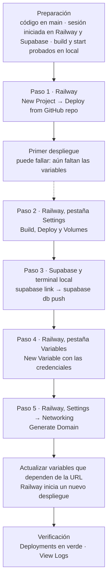

# Despliegue de Agente en Railway y Supabase

> **Síntesis.** Llevar el agente a producción no es un solo gesto sino una **secuencia ordenada**: vincular el repositorio de **GitHub** con **Railway**, definir los comandos de **construcción** y **arranque**, montar un **volumen** persistente, **migrar el esquema** a **Supabase** con su CLI e **inyectar las variables de entorno** que el código necesita. Solo al final se genera el **dominio público** y se actualizan las variables que dependen de esa URL. El orden importa porque cada paso alimenta al siguiente: sin variables el primer despliegue falla, y sin dominio no hay URL base que configurar.

## Introducción

La sesión anterior dibujó el plano: un Proyecto de Railway con sus Servicios y Volúmenes, Supabase Cloud como base de datos externa, OpenRouter como puerta a los LLMs y un puente con GitHub para el despliegue continuo. Esta sesión baja ese plano al terreno y es **práctica**: recorremos, en orden, lo que hay que hacer con las manos para que el agente deje de vivir en la máquina local y quede corriendo en un servidor público, conectado a una base de datos remota y listo para atender a usuarios reales. La imagen que ordena la clase es simple: **Railway es el motor** que mantiene vivo al agente las 24 horas, y **Supabase es su memoria de largo plazo**.

Para seguir el recorrido hacen falta cinco cosas: una cuenta en **Railway**, una cuenta en **Supabase**, un repositorio en **GitHub** con el código del agente, **Cursor** (o el IDE de preferencia) con su terminal, y la **CLI de Supabase** instalada localmente. No repetimos aquí la teoría de la topología ni del modelo PaaS —eso quedó en la [sesión 2](./02-railway-deployment-and-topology.md)—; el foco está en el *cómo*, en la forma de cada comando y en las trampas que conviene conocer de antemano. Este recorrido se concentra en el servicio del agente y su base de datos; la observabilidad con Langfuse queda fuera de él.

## Objetivos de aprendizaje

1. **Configurar** un proyecto en Railway vinculando un repositorio de GitHub para habilitar el despliegue continuo.
2. **Definir** los comandos de construcción y de arranque que ejecutan correctamente el entorno del agente.
3. **Implementar** un volumen persistente para que la información del servicio sobreviva a los reinicios.
4. **Ejecutar** migraciones desde el entorno local hacia producción con la CLI de Supabase.
5. **Establecer** las variables de entorno, las claves de API y el dominio público que garantizan la conectividad del agente en producción.

## Marco conceptual

### Del entorno local a producción: contenedores efímeros y persistencia

**Desplegar en producción** significa trasladar la aplicación desde la máquina local a un servidor remoto accesible por Internet, de forma continua, segura y escalable para los usuarios finales. Ese traslado cambia una suposición silenciosa que en local damos por hecha: que el disco es nuestro y que lo que escribimos en él se queda ahí. Plataformas como Railway ejecutan el código dentro de **contenedores efímeros**, es decir, entornos temporales que se crean y se destruyen con cada reinicio o actualización. La analogía de la clase es la de una **computadora que se formatea cada vez que se enciende**: arranca limpia, con el código y nada más.

La consecuencia es directa para cualquier agente que guarde información en archivos locales. Una base de datos **SQLite** (un motor de base de datos que vive en un único archivo) o los **logs** escritos en disco desaparecen en cuanto el contenedor se reinicia, y lo hace sin avisar. La solución son los **volúmenes persistentes**, que funcionan como un **disco duro externo conectado al contenedor**: lo que se escribe en ellos se conserva sin importar cuántas veces se reinicie o se actualice la aplicación. Ya conocíamos el concepto en abstracto desde la sesión 2; aquí lo vamos a montar de verdad, y para ello necesitamos primero saber cómo se enciende la aplicación.

### Comandos de construcción y arranque

Para que Railway sepa qué hacer con el código del repositorio necesita dos instrucciones distintas, que corresponden a dos momentos del ciclo de vida. El **comando de construcción** (*build*) prepara el código para producción: compila, empaqueta y deja todo listo para ejecutarse. En el ejemplo de la clase es `npm run build`. El **comando de arranque** (*start*) pone en marcha el proceso principal del agente y lo **mantiene vivo**: es lo que hace que el servicio siga respondiendo mientras nadie lo apague. En el ejemplo de la clase es `npm run start`.

La distinción importa porque cada comando falla de manera diferente y se corrige en un lugar diferente. Si la construcción rompe, el servicio ni siquiera llega a arrancar; si el arranque rompe, el código compiló bien pero el proceso principal cae al iniciar. Por eso la guía práctica insiste en probar ambos comandos en la terminal local **antes** de desplegar: lo que no arranca en tu máquina tampoco arrancará en el servidor, y es mucho más barato descubrirlo ahí.

### Migraciones: control de versiones de la base de datos

Cuando el agente pasa a producción también debe pasar su base de datos, pero "pasar" no significa copiar los datos locales. Las **migraciones** son un **control de versiones para la estructura de la base de datos**: archivos ordenados que describen, paso a paso, cómo se crean y se modifican las tablas y sus relaciones. Para llevar la base a producción no se exporta lo que hay en local; se **ejecutan esas migraciones en el servidor remoto**, que en nuestro caso es **Supabase** (el servicio de PostgreSQL en la nube). El resultado es una base remota con **la misma estructura** de tablas y relaciones que la local, pero vacía de datos de prueba y lista para recibir los de los usuarios reales.

Este enfoque tiene una ventaja que se aprecia con el tiempo: la estructura de la base queda registrada junto al código, en lugar de depender de la memoria de quien la creó a mano. La herramienta que ejecuta las migraciones contra el servidor remoto es la **CLI de Supabase**, y su uso concreto lo veremos en la guía. Antes toca hablar de lo último que falta para que el código funcione fuera de nuestra máquina: las credenciales.

### Variables de entorno en producción

Las **variables de entorno** son pares **clave-valor** que guardan información sensible o específica del entorno —claves de API, contraseñas, URLs— fuera del código. Su forma es siempre `CLAVE=VALOR`; por ejemplo, `TELEGRAM_BOT_TOKEN=12345:ABCDE`. En local viven en un archivo `.env`; en producción la regla es tajante: **nunca se suben al repositorio**. Se **inyectan desde el panel de control** del servidor, que en esta clase es Railway, de modo que el código las lee al ejecutarse pero ninguna queda escrita en el historial de GitHub.

La clase señala cuatro categorías que el agente necesita en producción. La tabla las resume con el ejemplo que da el temario.

| Categoría | Ejemplo | Para qué sirve |
|---|---|---|
| **Credenciales de la base de datos** | URL de conexión de Supabase | Permite al agente conectarse a la base de datos remota |
| **API keys de modelos de lenguaje** | `OPENROUTER_API_KEY` | Autoriza las peticiones del agente al proveedor de LLMs |
| **Tokens de mensajería** | `TELEGRAM_BOT_TOKEN` | Identifica al bot ante la plataforma de mensajería |
| **Configuración de almacenamiento** | `DATA_DIR=/data` | Indica al código dónde escribir, apuntando al volumen persistente |

La última fila conecta con lo que vimos al principio: el volumen existe como disco adjunto al contenedor, pero el código solo lo usará si una variable le dice que escriba en esa ruta. Volumen y variable de almacenamiento son, por tanto, dos mitades de una misma configuración. Con las piezas conceptuales a la vista, conviene fijar quién hace qué entre las dos plataformas.

### Railway y Supabase: qué hace cada uno

Los dos servicios se complementan y no compiten. **Railway** es la plataforma de infraestructura (**PaaS**) que **aloja, construye y mantiene en ejecución** el código del agente: toma el repositorio, ejecuta el comando de construcción y arranca el proceso. **Supabase** es el servicio de **base de datos PostgreSQL remota** donde el agente guarda su **información estructurada**: es la memoria que persiste con independencia de lo que le pase al servidor.

Esta división explica por qué el despliegue tiene dos frentes y por qué se atienden con herramientas distintas: lo relativo al código y al proceso se configura en el panel de Railway, mientras que lo relativo a la estructura de datos se gestiona desde la terminal local con la CLI de Supabase. Ambos frentes se encuentran en las variables de entorno, que es donde Railway aprende a hablar con Supabase.

### Guía de despliegue paso a paso

El recorrido completo sigue un orden deliberado. El diagrama lo muestra de punta a punta, con la plataforma o herramienta donde ocurre cada paso.



**Preparación.** Antes de tocar ninguna plataforma, el código del agente debe estar en la rama `main` de un repositorio de GitHub, y debes tener la sesión iniciada en Railway y en Supabase. Además, verifica en la terminal local que el proyecto construye y arranca, ejecutando los mismos comandos que luego configurarás en el servidor:

```bash
npm run build
npm run start
```

**Paso 1 — Vinculación del repositorio en Railway.** En el panel principal se hace clic en `New Project`, se elige `Deploy from GitHub repo` y se selecciona el repositorio del agente. Railway hace entonces una **preconfiguración inicial** detectando el lenguaje del proyecto. El progreso se sigue en la pestaña `Deployments` del servicio. Aquí aparece la primera sorpresa: el primer intento de despliegue **puede fallar, y es normal**, porque el servicio todavía no tiene las variables de entorno que el código necesita. No es un error de procedimiento, sino un síntoma de que aún falta configurar, y los pasos siguientes lo resuelven.

**Paso 2 — Comandos y volúmenes.** En la pestaña `Settings` del servicio se configuran tres cosas. En la sección `Build` se escribe el comando de construcción personalizado, `npm run build`. En la sección `Deploy` se escribe el comando de arranque, `npm run start`. Más abajo, en la sección `Volumes`, se pulsa `Add Volume` y se define el `Mount Path` como `/data`: es la ruta del contenedor donde quedará montado el disco persistente. Conviene **verificar que esa ruta esté bien escrita**, porque un error tipográfico montaría el volumen en un lugar donde el código nunca escribe y la persistencia sería ilusoria.

**Paso 3 — Supabase y migración.** En Supabase se crea el proyecto con `New Project`, indicando un nombre y una **contraseña segura** para la base de datos, y se espera unos minutos a que se aprovisione. Luego, desde la terminal local (Cursor o VS Code), se vincula el proyecto local con el remoto, reemplazando `[PROJECT_REF]` por el identificador alfanumérico del proyecto en Supabase:

```bash
supabase link --project-ref [PROJECT_REF]
```

La terminal pide la contraseña de la base de datos remota; es la misma que se definió al crear el proyecto. Con el vínculo establecido, las migraciones locales se suben a producción:

```bash
supabase db push
```

Para confirmar que todo salió bien, se abre el `Table Editor` de Supabase y se comprueba que las tablas fueron creadas.

**Paso 4 — Variables de entorno obligatorias.** En la pestaña `Variables` del servicio en Railway se usa `New Variable` para agregar las credenciales, copiándolas del `.env` local. Hay que incluir y revisar las cuatro categorías del apartado anterior: las credenciales de la base de datos (la URL de conexión de Supabase), las API keys de modelos de lenguaje (por ejemplo `OPENROUTER_API_KEY`), los tokens de mensajería (por ejemplo `TELEGRAM_BOT_TOKEN`) y la configuración de almacenamiento que apunta al volumen (por ejemplo `DATA_DIR=/data`, coherente con el `Mount Path` del paso 2).

**Paso 5 — Despliegue final y actualización de URLs.** En `Settings`, sección `Networking`, se pulsa `Generate Domain` para obtener la **URL pública** del servicio. Se copia ese dominio, se vuelve a `Variables` y se actualiza cualquier variable que necesite la URL base, como las de los **webhooks** (direcciones a las que un servicio externo envía eventos). Al modificar variables, Railway inicia automáticamente un nuevo despliegue; la alternativa es hacer un nuevo commit en `main`, que dispara el despliegue con la configuración completa. Para cerrar, en `Deployments` se verifica que el estado sea de éxito (verde) y se revisa `View Logs` para confirmar que el agente corre y queda esperando instrucciones.

### Advertencias y orden de operaciones

El recorrido anterior está lleno de dependencias entre pasos, y casi todos los tropiezos típicos nacen de saltárselas. La tabla reúne las advertencias de la clase junto con la razón detrás de cada una.

| Advertencia | Por qué importa | Cómo evitarlo |
|---|---|---|
| **No subir el `.env` a GitHub** | Expone credenciales y API keys a cualquiera con acceso al repositorio | Mantener el `.env` fuera del repo e inyectar las variables desde el panel de Railway |
| **Precaución con `db push`** | Altera la estructura de la base de **producción** y no se deshace fácilmente | Revisar qué migraciones se van a aplicar y confirmar que el proyecto vinculado es el correcto antes de ejecutarlo |
| **El primer despliegue suele fallar** | Aún no existen las variables de entorno que el código requiere | Es esperable: configurar el resto de pasos y volver a desplegar |

Hay además dos asuntos de orden que no son advertencias sino lógica de dependencias. El primero: el **dominio se genera antes** de actualizar las variables que dependen de la URL, porque esas variables necesitan un valor que solo existe una vez que Railway lo emite. Invertir el orden dejaría esas variables apuntando a una dirección inexistente o a un valor provisional. El segundo: como Railway **redespliega automáticamente** cuando cambian las variables, el momento ideal para ajustarlas es justo después de generar el dominio, de modo que ese redespliegue ya arranque con la configuración completa y se evite encadenar despliegues innecesarios.

## Síntesis

Desplegar el agente es recorrer una cadena en la que cada eslabón habilita al siguiente. GitHub entrega el código a Railway, los comandos de construcción y arranque le dicen cómo preparar y mantener vivo el proceso, y el volumen montado en `/data` le da un disco que sobrevive a los reinicios de un contenedor que, por naturaleza, se formatea. En paralelo, las migraciones ejecutadas con la CLI de Supabase recrean en la nube la estructura de la base de datos sin arrastrar datos locales, y las variables de entorno —inyectadas por el panel, jamás por el repositorio— conectan al agente con esa base, con el LLM y con la plataforma de mensajería. El dominio público cierra el circuito: se genera al final porque de él dependen las últimas variables, y al actualizarlas Railway redespliega con todo en su sitio. Dos cautelas atraviesan el proceso: el primer despliegue fallido es normal y no una señal de error, y `db push` toca producción y no se deshace fácilmente.

## Preguntas de repaso

1. ¿Por qué el primer despliegue en Railway suele fallar y por qué eso es normal? ¿Qué paso de la guía lo resuelve?
2. ¿Qué se pierde al reiniciar un contenedor si no hay un volumen persistente, y por qué ocurre? Explica con la analogía de la computadora que se formatea y el disco externo.
3. ¿Qué hace `supabase db push` y por qué es una operación delicada? ¿Qué diferencia hay entre ejecutar migraciones en Supabase y copiar los datos locales?
4. ¿Por qué el archivo `.env` no debe subirse a GitHub y cómo llegan entonces las variables al servicio en producción?
5. ¿Por qué se genera el dominio público antes de actualizar las variables que dependen de la URL, y qué ocurre en Railway cuando esas variables cambian?

## Recursos

- [Railway](https://railway.com) — la PaaS donde se construye, aloja y mantiene en ejecución el código del agente. Su [documentación](https://docs.railway.com) es la referencia de los paneles y pestañas usados en la guía, y la [referencia de volúmenes](https://docs.railway.com/volumes/reference) detalla el disco persistente y su `Mount Path`.
- [Supabase](https://supabase.com) — el servicio de PostgreSQL remoto donde el agente guarda su información estructurada.
- [CLI de Supabase](https://supabase.com/docs/reference/cli/introduction) — la herramienta de línea de comandos que vincula el proyecto local con el remoto (`supabase link`) y sube las migraciones (`supabase db push`).
- [Migraciones de base de datos en Supabase](https://supabase.com/docs/guides/deployment/database-migrations) — la guía oficial sobre cómo versionar y desplegar los cambios de esquema.
- [GitHub](https://github.com) — el repositorio, en la rama `main`, que se vincula con Railway para el despliegue continuo.
- Conexión interna: [Despliegue y Topología en Railway](./02-railway-deployment-and-topology.md) — la sesión 2, que explicó el modelo PaaS, la jerarquía Proyecto-Servicio-Volumen y el flujo CI/CD con GitHub; esta sesión es su contraparte práctica.
- Conexión interna: [Configuración inicial de un agente de IA con Supabase](../week-04/02-ai-agent-supabase-initial-setup.md) — donde nació la base de datos local y sus migraciones, que ahora se replican en el Supabase de producción.
- Conexión interna: [Integración del LLM vía OpenRouter en el entorno local](../week-04/03-openrouter-llm-integration-local-env.md) — origen de la `OPENROUTER_API_KEY` que ahora se vuelve una variable de entorno en Railway.
- Conexión interna: [Integración de un agente de IA local con Telegram](../week-04/04-telegram-integration-local-agent.md) — origen del token del bot y del problema del webhook, que en producción pasa a resolverse con el dominio público.
- Conexión interna: [Herramientas de manipulación de archivos para agentes IA](../week-05/04-file-manipulation-tools-ai-agents.md) — las herramientas que escriben en disco y, por tanto, las que justifican montar un volumen persistente.

## Notas personales

> Observaciones al contrastar la clase, que usa un ejemplo genérico, con el proyecto real `projects/10x-builders-agent`. Lo marcado como *pendiente* está inferido del código y hay que confirmarlo al desplegar.

### Build y start en un monorepo

En clase el despliegue se reduce a `npm run build` y `npm run start`. Nuestro proyecto es un **monorepo** (un único repositorio con varios paquetes) con workspaces de npm y Turborepo: `apps/web`, `packages/agent`, `packages/db`, `packages/config` y `packages/types`. El `package.json` raíz define `build` (que delega en `turbo run build`), `dev`, `lint` y `type-check`, pero **no define `start`**. El único `start` es `next start`, dentro de `apps/web/package.json`. Además, el agente no es un proceso aparte: vive dentro de la app Next.js, y su punto de entrada es el webhook de Telegram en `apps/web/src/app/api/telegram/webhook/route.ts`. *Pendiente:* el comando de arranque en Railway no puede ser el `npm run start` de la raíz tal cual; hay que apuntarlo al workspace `apps/web`.

### Migraciones: desde dónde correr la CLI

La clase da por hecho que `supabase link` y `supabase db push` se ejecutan "desde tu proyecto local", como si la carpeta `supabase/` estuviera en la raíz. En nuestro proyecto vive en `packages/db/supabase/`, con su `config.toml` y la carpeta `migrations/`, que hoy contiene **8 migraciones** (`00001` a `00008`). *Pendiente:* correr la CLI desde `packages/db`, o bien indicar esa ruta con `--workdir`, para que encuentre la configuración y las migraciones.

### El volumen y `DATA_DIR`

El ejemplo de la clase gira en torno a `DATA_DIR=/data` y a lo que se perdería con SQLite o logs locales. En nuestro proyecto `DATA_DIR` **no existe** y **no se usa SQLite**: los datos viven en Supabase, en la tabla `memories` y en los checkpoints de LangGraph, que se guardan en Postgres mediante `@langchain/langgraph-checkpoint-postgres` a través de `DATABASE_URL`. Lo que sí escribe en disco son las herramientas de archivos y de bash, confinadas por `FILE_TOOLS_WORKSPACE_ROOT` y `BASH_WORKSPACE_ROOT`; esas dos variables son las que apuntarían al `Mount Path` del volumen (`/data`). La consecuencia práctica es que, **sin volumen, no se pierde la base de datos** (está fuera de Railway), pero sí los archivos que el agente crea o edita en su workspace. Esto conecta con las [herramientas de manipulación de archivos](../week-05/04-file-manipulation-tools-ai-agents.md) y con la distinción que ya hacía la [sesión 2](./02-railway-deployment-and-topology.md) entre la información estructurada en Supabase y los archivos del disco del servicio.

### Más variables de las que cita la clase

La clase menciona cuatro: la URL de la base de datos, `OPENROUTER_API_KEY`, `TELEGRAM_BOT_TOKEN` y `DATA_DIR`. El proyecto maneja bastantes más, agrupadas así según los `.env.example` de la raíz y de `apps/web`:

| Grupo | Variables |
|---|---|
| **Supabase** | `NEXT_PUBLIC_SUPABASE_URL`, `NEXT_PUBLIC_SUPABASE_ANON_KEY`, `SUPABASE_SERVICE_ROLE_KEY` (solo servidor; se salta RLS, las reglas de seguridad por fila de Postgres), `DATABASE_URL` |
| **LLM** | `OPENROUTER_API_KEY` y los modelos `OPENROUTER_MODEL`, `OPENROUTER_COMPACTION_MODEL`, `OPENROUTER_MEMORY_MODEL`, `OPENROUTER_EMBEDDING_MODEL` |
| **Telegram** | `TELEGRAM_BOT_TOKEN`, `TELEGRAM_WEBHOOK_SECRET`, `TELEGRAM_WEBHOOK_BASE_URL` |
| **URL pública** | `NEXT_PUBLIC_APP_URL` |
| **Seguridad y otros** | `CRON_SECRET`, `OAUTH_ENCRYPTION_KEY`, credenciales OAuth de GitHub y Google, `LANGFUSE_*` |
| **Banderas** | `ALLOW_FILE_TOOLS`, `ALLOW_BASH_TOOL`, `ALLOW_SCHEDULED_TASKS_TOOL` |

No todas son obligatorias para un primer despliegue, y la `SUPABASE_SERVICE_ROLE_KEY` merece un cuidado especial por saltarse RLS. Un detalle que sí coincide con la advertencia de la clase: el `.env.local` de `apps/web` está **ignorado por git**, así que las credenciales no viajan al repositorio.

### Dominio público y variables que dependen de él

La clase indica que, tras `Generate Domain`, se actualizan las variables que necesiten la URL base. En el proyecto dependen del dominio dos variables: `NEXT_PUBLIC_APP_URL`, usada en los redirects de OAuth y en los enlaces (por defecto cae a `http://localhost:3000`), y `TELEGRAM_WEBHOOK_BASE_URL`, que `/api/telegram/setup` usa para registrar el webhook ante Telegram. En local ese papel lo cumplía ngrok (ver la [integración con Telegram](../week-04/04-telegram-integration-local-agent.md)); en Railway lo reemplaza el dominio generado. Hay un matiz propio de Next.js: las variables `NEXT_PUBLIC_*` se **incrustan en tiempo de build**, así que cambiarlas exige un nuevo despliegue, algo que Railway dispara solo al modificar variables (conviene confirmar al desplegar que ese redespliegue incluye la fase de build). *Pendiente:* volver a llamar a `/api/telegram/setup` para que Telegram apunte al dominio nuevo.
