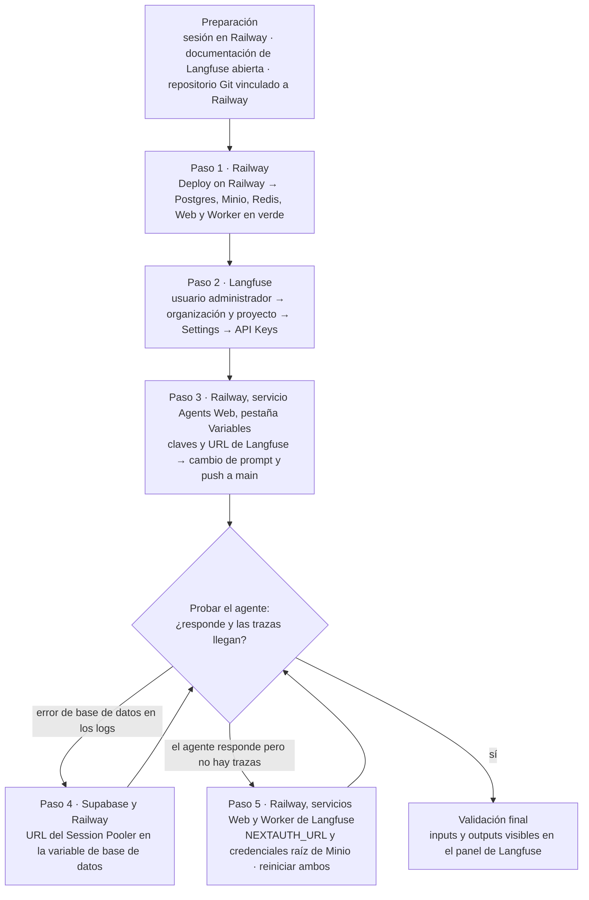

# Despliegue de Langfuse en Railway para Observabilidad de LLMs

> **Síntesis.** La observabilidad en producción se despliega como un **conjunto de servicios** levantado con una **plantilla de un clic** y se conecta al agente mediante **claves y una URL**. Los dos fallos típicos —la **red hacia Supabase**, que se resuelve con el **session pooler**, y la **coherencia de variables entre Web y Worker** (`NEXTAUTH_URL` y las credenciales de Minio)— no se adivinan: se resuelven **leyendo los logs** y comprobando en el panel que las **trazas llegan**.

## Introducción

Esta sesión cierra un hilo que viene de lejos. En la semana 7 instrumentamos el agente para que enviara **trazas** a Langfuse, pero lo hicimos contra una instancia local. En la [sesión 2](./02-railway-deployment-and-topology.md) dibujamos la topología de producción y vimos que Langfuse tiene su propio lugar como servicio dentro del proyecto de Railway. En la [sesión 3](./03-railway-supabase-agent-deployment.md) llevamos el agente a Railway y Supabase, y dejamos la observabilidad fuera del recorrido. Ahora toca juntar las tres piezas: **Langfuse sale de local y se despliega en Railway**, y el agente que ya corre en producción empieza a registrar en él cada interacción.

La clase es **práctica** y su premisa es que entender cómo se comporta un LLM en producción exige verlo, no suponerlo. Para seguirla hacen falta cuatro cosas: una cuenta en **Railway** con acceso al proyecto donde vive el agente, **Langfuse** (concretamente su documentación, de donde sale la plantilla de despliegue), una cuenta de **Supabase** y un **repositorio Git** con el código del agente. No repetimos aquí la teoría de la PaaS, los volúmenes o las variables de entorno, ni el despliegue del agente: eso quedó en las sesiones 2 y 3. El foco está en levantar Langfuse, conectarlo y resolver los dos problemas de configuración que casi siempre aparecen.

## Objetivos de aprendizaje

1. **Desplegar** Langfuse y sus servicios dependientes (Postgres, Minio y Redis) con la plantilla preconfigurada de Railway.
2. **Configurar** una organización y un proyecto en Langfuse y generar las credenciales de API para integrarlas en el agente.
3. **Resolver** problemas de conexión con Supabase usando la URL del session pooler en lugar de la conexión directa.
4. **Ajustar** las variables de autenticación y almacenamiento (NextAuth y Minio) para que las trazas lleguen a Langfuse.
5. **Validar** en el panel de Langfuse que se registran los inputs y outputs del agente.

## Marco conceptual

### Langfuse y la "caja negra" del avión

**Langfuse** es una plataforma **open source** de **observabilidad** y analítica pensada para aplicaciones con **LLMs** (modelos de lenguaje de gran tamaño). Permite **rastrear, evaluar y depurar** el comportamiento de los modelos porque registra métricas detalladas de cada ejecución: no solo si el agente respondió, sino cómo llegó a esa respuesta. Cada una de esas ejecuciones queda guardada como una **traza**, el registro de una interacción del agente con sus entradas (*inputs*) y salidas (*outputs*).

La analogía que ordena la clase es la **caja negra de un avión comercial**. Un agente toma decisiones complejas generadas por un modelo, y cuando algo falla o la respuesta es inesperada, hace falta un registro exacto de **qué prompt se usó, qué contexto tenía y qué devolvió**. Sin ese registro, investigar un incidente es reconstruir a ciegas; con él, se parte de evidencia. Langfuse cumple ese papel y, además, habilita la evaluación de modelos mediante jueces, la técnica conocida como **LLM as a judge**, en la que un modelo de lenguaje evalúa las respuestas de otro. Para que esa caja negra exista en producción hay que desplegarla, y ahí entran las plantillas.

### Plantillas de despliegue de un clic

Montar a mano todo lo que Langfuse necesita sería largo y propenso a errores. Por eso plataformas como Railway ofrecen **plantillas de despliegue de un clic** (*1-Click Deploy*): configuraciones preparadas que **empaquetan varios servicios** —bases de datos, cachés, aplicaciones web— en un solo despliegue. En lugar de crear cada pieza y cablearla con las demás, se acepta la plantilla y la plataforma levanta el conjunto ya conectado.

La plantilla de Langfuse levanta cinco servicios. **Postgres** es una base de datos relacional, **Minio** es un almacenamiento de objetos compatible con S3 (la interfaz de almacenamiento de objetos popularizada por AWS) y **Redis** es una caché en memoria. Junto a ellos corren los dos servicios propios de Langfuse: **Web**, la aplicación que ofrece el panel de control y tiene la URL pública, y **Worker**, el proceso que lo acompaña y que, como veremos, debe compartir con Web la misma configuración de almacenamiento. Que sean cinco servicios y no uno explica por qué los fallos más frecuentes no están en ninguna pieza aislada, sino en **cómo se hablan entre sí**. Antes de llegar a eso hay que ver cómo se habla el agente con Langfuse.

### Credenciales y variables de entorno

Para que el agente envíe trazas a Langfuse necesita identificarse y saber a dónde enviarlas. Lo primero lo resuelven las **claves de API**, un par formado por la **Public Key** (clave pública) y la **Secret Key** (clave secreta). Lo segundo, la **URL del host**, la dirección pública del servicio web de Langfuse. Las tres se generan dentro de Langfuse: se crea una **organización**, dentro de ella un **proyecto**, y en el proyecto se crean las credenciales desde su configuración.

Como vimos en la sesión 3, las **variables de entorno** son pares clave-valor que mantienen fuera del código la información sensible o específica del entorno. Las tres credenciales viajan por ese canal: se **inyectan desde el panel de Railway** en el servicio del agente, de modo que el código las lee al ejecutarse y ninguna queda escrita en el repositorio. El detalle de qué variables concretas hay que tocar en Langfuse mismo lo trataremos al final, porque está ligado a los problemas de diagnóstico. Antes conviene entender el primero de esos problemas, que no está en Langfuse sino en la base de datos del agente.

### Session pooler frente a conexión directa en Supabase

Cuando una aplicación desplegada en una plataforma como Railway se conecta a una base de datos en la nube, **restricciones de red** pueden impedir la conexión. El caso que recoge la clase es la **falta de soporte nativo de IPv4** (la versión de direcciones de red más extendida) en ciertos entornos: la URL de **conexión directa** de Supabase puede no ser alcanzable desde allí, y el síntoma es un error de conexión a la base de datos en los logs del agente.

La salida es el **session pooler**, un **intermediario** que gestiona las conexiones hacia la base de datos de forma más robusta que la conexión directa. El cambio es pequeño en la práctica: se copia, desde la configuración de la base de datos en Supabase, la URL del session pooler y se usa **en lugar de** la directa en la variable de conexión del agente. Resuelto el acceso a los datos, queda por situar a cada herramienta en el conjunto.

### Roles de cada herramienta

Cuatro herramientas se reparten el trabajo, y conviene tener claro qué hace cada una antes de seguir con la guía, porque eso es lo que permite ubicar un fallo en el componente correcto.

| Herramienta | Rol |
|---|---|
| **Railway** | PaaS que aloja todo el ecosistema: el agente y los servicios de Langfuse |
| **Langfuse** | Herramienta de observabilidad: ofrece el panel de control donde se consultan las trazas |
| **Supabase** | Base de datos principal del agente |
| **Minio** | Almacenamiento de objetos compatible con S3 donde Langfuse guarda los datos pesados de las trazas |

Hay una distinción que evita confusiones: Supabase y Minio son **almacenes distintos con funciones distintas**. Supabase guarda lo que el agente necesita para trabajar; Minio guarda lo que Langfuse necesita para registrar lo que el agente hizo. Con los roles definidos, podemos recorrer el despliegue completo.

### Guía de despliegue paso a paso

El recorrido va de levantar la infraestructura a validar que las trazas llegan. Los pasos 4 y 5 son **condicionales**: solo se aplican si al probar aparece el síntoma correspondiente, y el diagrama lo refleja con una verificación intermedia.



**Preparación.** Antes de empezar, debes tener la sesión iniciada en Railway con acceso al proyecto donde está el agente principal, abrir la documentación oficial de Langfuse para tener a mano el enlace de la plantilla y verificar que el repositorio Git esté vinculado a Railway, de modo que los despliegues automáticos sigan funcionando.

**Paso 1 — Despliegue inicial de la infraestructura.** En la documentación de Langfuse se localiza la sección de despliegue en Railway y se pulsa el botón de la plantilla, `Deploy on Railway`. En Railway se aceptan los permisos predeterminados para iniciar la instalación de los servicios (Postgres, Minio, Redis, Web y Worker). Tras esperar unos minutos, se comprueba en el lienzo del proyecto que todos los servicios muestren el indicador verde de activos.

**Paso 2 — Organización y credenciales de API.** Se abre el servicio Web de Langfuse en Railway y, desde ahí, su URL pública generada. En esa dirección se crea el **usuario administrador inicial** y, dentro de Langfuse, una nueva organización y un proyecto. Luego se va a `Settings` y a `API Keys` para crear las credenciales nuevas, y se copian en un lugar seguro: la clave pública, la clave secreta y la URL del host. Para cerrar el paso, se verifica que se tiene acceso total al dashboard del proyecto recién creado.

**Paso 3 — Integración de variables en el agente.** De vuelta en Railway, se entra al proyecto del agente principal, cuyo servicio en el curso se llama `Agents Web`, y en su pestaña `Variables` se añaden las variables de Langfuse copiadas en el paso anterior. Después, en local, se hace una pequeña modificación en el prompt del sistema del agente y se hace push a `main`. La gracia de ese cambio mínimo es doble: al verlo reflejado en la aplicación en producción tras el despliegue automático, se comprueba que el **CI/CD sigue funcionando** y que el agente corre con la configuración nueva.

**Paso 4 — Problemas de conexión con Supabase.** Si al probar el agente aparece un error en los logs, se revisa si es de conexión a Supabase, posiblemente por el tema de IPv4. En el panel de Supabase se abre la configuración de la base de datos y se copia la URL de conexión del **Session Pooler**, en lugar de la conexión directa. En la pestaña `Variables` del agente en Railway se actualiza la variable de conexión a la base de datos con esa URL. Al reiniciar el servicio, el agente debe volver a responder sin errores de base de datos.

**Paso 5 — Variables de Minio y NextAuth.** Si se interactúa con el agente pero las trazas no llegan, el problema está en la **comunicación interna de Langfuse**. En el servicio Web de Langfuse, pestaña `Variables`, se busca `NEXTAUTH_URL` y se actualiza para que coincida **exactamente** con el dominio público que Railway generó para ese servicio. **NextAuth** es la librería de autenticación sobre la que se apoya el panel, y esta variable le indica cuál es su dirección pública. Después se revisan las variables de Minio: las credenciales de acceso raíz deben estar configuradas de forma **idéntica** en el servicio Web y en el Worker. El ejemplo de variables a revisar es este, con valores de relleno que se sustituyen por los reales:

```
MINIO_ROOT_USER=tu_usuario
MINIO_ROOT_PASSWORD=tu_contraseña
NEXTAUTH_URL=https://tu-url-de-railway.app
```

Hecho el ajuste, se reinician **ambos servicios**, Web y Worker, en Railway. La prueba final consiste en enviar un mensaje al agente y comprobar en el panel de Langfuse que los inputs y outputs, es decir, las trazas, quedan registrados.

### Diagnóstico: síntoma, causa y arreglo

Los dos pasos condicionales son en realidad una forma de **diagnosticar**, y conviene poder razonar de síntoma a causa en lugar de recordar recetas. La tabla ordena cada situación que recoge la clase.

| Síntoma | Causa probable | Arreglo |
|---|---|---|
| Error de base de datos en los logs del agente | Se usa la **conexión directa** de Supabase y el entorno no soporta IPv4 de forma nativa | Sustituir la variable de conexión por la URL del **Session Pooler** y reiniciar el servicio |
| El agente responde, pero las trazas no llegan | `NEXTAUTH_URL` no coincide con el dominio público del servicio Web, o las credenciales raíz de Minio difieren entre Web y Worker | Igualar la URL al dominio público y las credenciales de Minio en ambos servicios; reiniciar Web y Worker |
| Las trazas no se procesan | Un error tipográfico en una URL o una discordancia de credenciales entre Web y Worker | Revisar las variables una por una, comparando ambos servicios |
| Bloqueos al conectar con bases de datos externas | Restricciones de red entre la plataforma y la base de datos | Verificar si hace falta usar **proxies** o **poolers** de conexiones |

La lección de fondo es la advertencia que la clase repite: **la configuración precisa de las variables de entorno es fundamental**. Ninguno de estos fallos es un defecto de las herramientas; todos nacen de un valor que no coincide con otro. Por eso el método es siempre el mismo: leer los logs para saber en qué componente falla y confirmar el arreglo comprobando que las trazas aparecen en el panel.

## Síntesis

Desplegar la observabilidad es, en el fondo, extender la topología que ya conocíamos. Railway aloja el agente y, ahora también, el conjunto de servicios de Langfuse que levanta la plantilla de un clic: Postgres, Minio, Redis, Web y Worker. Langfuse es la caja negra del agente, y se conecta a él con un par de claves y la URL del host inyectados como variables de entorno. Dos fallos concentran casi todos los problemas: la **red hacia Supabase**, que se evita usando la URL del session pooler en lugar de la conexión directa, y la **coherencia de las variables entre Web y Worker**, donde `NEXTAUTH_URL` debe coincidir con el dominio público y las credenciales de Minio deben ser idénticas en ambos. La prueba que cierra el trabajo no es ver los servicios en verde, sino enviar un mensaje al agente y encontrar su input y su output registrados en el panel de Langfuse.

## Preguntas de repaso

1. ¿Por qué se compara a Langfuse con la caja negra de un avión comercial? ¿Qué información concreta debería poder recuperarse de ella ante una respuesta inesperada del agente?
2. ¿Qué servicios levanta la plantilla de un clic de Langfuse en Railway y para qué sirve cada uno?
3. ¿Por qué puede fallar la conexión del agente a Supabase desde Railway y qué cambia al usar el session pooler en lugar de la conexión directa?
4. ¿Qué dos ajustes hacen que las trazas lleguen a Langfuse (`NEXTAUTH_URL` y las credenciales de Minio en Web y Worker) y por qué cada uno es necesario?
5. ¿Cómo se comprueba de punta a punta que la integración funciona, y qué diferencia hay entre ver los servicios en verde y ver las trazas en el panel?

## Recursos

- [Railway](https://railway.com) — la PaaS que aloja todo el ecosistema, tanto el agente como los servicios de Langfuse. Su [documentación](https://docs.railway.com) es la referencia de los paneles y pestañas usados en la guía.
- [Langfuse](https://langfuse.com) — la plataforma open source de observabilidad para LLMs que recibe las trazas del agente. Su [guía de despliegue en Railway](https://langfuse.com/self-hosting/deployment/railway) es donde se encuentra la plantilla de un clic.
- [Supabase](https://supabase.com) — la base de datos principal del agente, cuya URL del session pooler se usa para evitar los fallos de red.
- [MinIO](https://min.io) — el almacenamiento de objetos compatible con S3 donde Langfuse guarda los datos pesados de las trazas.
- [Redis](https://redis.io) — la caché que la plantilla despliega junto al resto de servicios de Langfuse.
- Conexión interna: [Integración de Langfuse en Agentes de LangGraph](../week-07/03-langfuse-integration-langgraph-agents.md) — instrumentó el agente con Langfuse y lo levantó en local con docker-compose; aquí ese mismo servicio pasa a vivir en Railway.
- Conexión interna: [Tracing y Observabilidad de Agentes de IA con Langfuse](../week-07/04-langfuse-tracing-reactive-debugging.md) — enseña a leer las trazas en el panel, que es lo que se hace en la validación final.
- Conexión interna: [Despliegue y Topología en Railway](./02-railway-deployment-and-topology.md) — la sesión 2, que presentó a Langfuse como un servicio más de la topología de producción.
- Conexión interna: [Despliegue de Agente en Railway y Supabase](./03-railway-supabase-agent-deployment.md) — la sesión 3, con el agente ya desplegado al que ahora se conecta Langfuse.

## Notas personales

> Contraste entre la clase, que usa un ejemplo genérico, y el proyecto real `projects/10x-builders-agent`. Lo marcado como *pendiente* está inferido y hay que confirmarlo al desplegar.

### Cómo se conecta Langfuse en el proyecto

El agente usa el `CallbackHandler` de `langfuse-langchain`, definido en `packages/agent/src/observability.ts`, con tres variables: `LANGFUSE_PUBLIC_KEY`, `LANGFUSE_SECRET_KEY` y `LANGFUSE_BASE_URL` (el código acepta también `LANGFUSE_BASEURL`). El `.env.example` apunta a `http://localhost:3001`; en Railway ese valor pasa a ser la URL pública del servicio Web de Langfuse. Un detalle que conviene tener presente: si faltan las claves, el handler queda en `null` y el agente **sigue funcionando sin trazar**. Es decir, "las trazas no llegan" no deja ninguna excepción en los logs, y la única forma de saberlo es comprobarlo en el panel.

### El session pooler es un requisito, no solo un parche

En la clase el session pooler aparece como la salida a un problema de IPv4. En el proyecto es algo más: `DATABASE_URL` la usa el checkpointer de LangGraph (`packages/agent/src/checkpointer.ts`), y el código exige el **session pooler (puerto 5432)** y no el transaction pooler, para que los *advisory locks* (bloqueos cooperativos de Postgres) sobrevivan al reanudar un flujo de Human-in-the-Loop. Además de resolver el IPv4, el session pooler es justo lo que el proyecto necesita.

### Lo que la clase no lista

El temario enumera Postgres, Minio, Redis, Web y Worker. La guía oficial de Langfuse para Railway habla también de **ClickHouse** y pide verificar que Postgres y ClickHouse usen UTC. Aclara, además, que la plantilla se mantiene fuera de la organización de Langfuse, con soporte *best effort* y sobre la versión 3. *Pendiente:* confirmar qué servicios aparecen realmente al desplegar.
